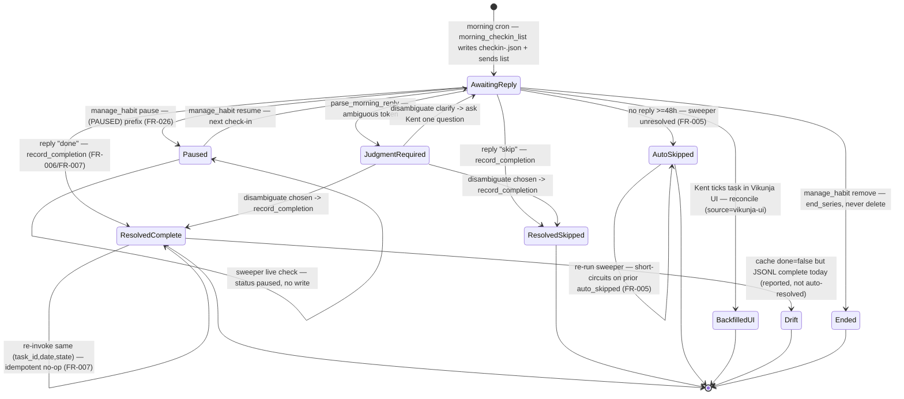

# Habits Process Flow

> **Divio type: Explanation / Reference (current-state).** This is not a runbook.
> It describes *what the system does today* for the habit completion lifecycle —
> the actors, the states, the operating rules (with the FR/INV IDs they enforce),
> and the code seams that implement them.

## Why this document exists

The habits lifecycle spans several missions and a subtle split between what Vikunja
owns (native recurrence-rule scheduling — an RFC 5545 RRULE since #1111 — and "done today") and what Felix owns
(per-occurrence completion **history**, because Vikunja discards repeating-task
occurrence history — context for [#729](https://github.com/kentonium3/kg-automation/issues/729)).
This is the single canonical explanation, crediting the missions that built it.

| Contribution | Origin issue / mission |
|---|---|
| Three-write atomic `record_completion` (done=true + `[Felix]` comment + JSONL append), idempotent on `(task_id,date,state)`; native `repeat_after`/`repeat_mode` canonical for scheduling | `habits-native-repeat-jsonl-state-01KS0M59` (FR-006, FR-007, C-005; ADR-0002) |
| Preserve `repeat_after`/`repeat_mode` on the completion POST (read-modify-write) | [#524](https://github.com/kentonium3/kg-automation/issues/524) |
| EOD-ET `due_date` write (`23:59:59±HH:MM`, never `Z`) + regression guard | [#112](https://github.com/kentonium3/kg-automation/issues/112); ET-vs-UTC date fix [#733](https://github.com/kentonium3/kg-automation/issues/733); canonical helpers [#761](https://github.com/kentonium3/kg-automation/issues/761) |
| Day-specific `repeat_after=0`/sub-week no-rearm ratchet at schedule-load | [#607](https://github.com/kentonium3/kg-automation/issues/607) / [#608](https://github.com/kentonium3/kg-automation/issues/608) |
| `correlated_checkin_date_et` piped into resolution | [#515](https://github.com/kentonium3/kg-automation/issues/515) / mission #408 WP-02 |
| 48h auto-skip sweeper (idempotent, day-specific EOD-ET advance) | `habit-day-specific-scheduling-01KT48Y6` (FR-003, FR-005) |
| JSONL is canonical history; comment is a UI mirror; weekly report reads the JSONL not `done_at` | ADR-0002 Phase 2; `trustworthy-weekly-habit-report-01KV4GZ7` ([#605](https://github.com/kentonium3/kg-automation/issues/605)) |
| Deterministic weekly cron driver with truthful delivery confirmation | `deterministic-cron-hardening-01KXA4PX` ([#723](https://github.com/kentonium3/kg-automation/issues/723)) |
| Weekly-report ownership: deterministic `felix-habits-weekly` timer owns it; habits out-of-scope (dedicated LLM agent declined) | [#409](https://github.com/kentonium3/kg-automation/issues/409) / [#796](https://github.com/kentonium3/kg-automation/issues/796) |
| RRULE adaptation: completion as a v2 merge patch `{done:true}` (the v1 POST echo of `repeat_after` is gone); sweeper advances day-specific habits to the rule's next occurrence; schedule declares `rrule` + read-only drift check; weekly report classifies from the rule; pause/resume/remove helper; `migrate_schedule` and `--reconcile-schedule` retired | `felix-rrule-adaptation-01M7TKNX` ([#1111](https://github.com/kentonium3/kg-automation/issues/1111); FR-003, FR-004, FR-012, FR-013, FR-018, FR-026) |

## Actors & trigger

- **`felix-admin-habits`** (OpenClaw agent, Sonnet; Assisted / Level 1) — delivers
  the morning check-in and records completions from Kent's replies. Every
  deterministic step is delegated to a helper (Constitution Directive 6). Emits
  either the literal `[felix-admin-habits]: IDLE` token or a message behind the
  identity line `Sent by felix-admin-habits:<model>`.
- **Kent** — receives the WhatsApp check-in, replies with completion/skip text,
  and issues out-of-band add/pause/resume/remove commands, which the agent
  carries out through `scripts/habits/manage_habit.py` (#1111).
- **`felix-habit-sweeper`** — stateless Python oneshot (`scripts/habits/sweeper.py`),
  fired by a systemd user timer daily ~07:30 ET; zero LLM. Closes the 48h response
  window with `auto_skipped` events. (Timer stopped and disabled 2026-11-19 as
  #1111 containment; it is re-enabled on Kent's go — habits-ops.md.)
- **Vikunja** (the v2.8.0-rrule fork, project 13 "Habits") — source of truth for
  *when a habit is due* (each habit's RRULE, e.g. `FREQ=DAILY;INTERVAL=1` or
  `FREQ=WEEKLY;BYDAY=MO`) and *done today* (`done=true` → Vikunja advances the
  series by its rule). It **discards** repeating-task occurrence history. Felix
  writes it only through `PATCH /api/v2/tasks/{id}` merge patches with a readback,
  because a v1 `POST /tasks/{id}` replaces the task and strips the rule.
- **`habits-history.jsonl`** (`/data/services/openclaw/state/habits-history.jsonl`)
  — canonical append-only completion history (ADR-0002 `state_log`, domain
  `"habits"`).

**Triggers** (three entry points into the same lifecycle):
1. **Morning cron** → agent runs `morning_checkin_list`, writes
   `morning-checkin-<date>.json`, sends the WhatsApp list.
2. **Kent's reply** → agent runs `parse_morning_reply` → `record_completion` per tuple.
3. **Sweeper timer** (07:30 ET) → `sweeper.run_sweep` auto-skips habits unresolved >48h.

## Flow & states

```
MORNING CRON (felix-admin-habits tick)
  │  python3 -m scripts.habits.morning_checkin_list --date <ET today>
  ▼  morning-checkin-<date>.json  ── from the sync cache: habits due<=today AND done=false AND not (PAUSED),
  │                                    minus already-in-history-today
  ▼  WhatsApp list sent                                              [state: AWAITING_REPLY]
  │
  ├── Kent replies (any time) ─► parse_morning_reply --reply … --date <ET today>
  │       → tuples[](task_id,state) + correlated_checkin_date_et (#515) + judgment_required[]
  │       │
  │       ▼ per tuple, exactly once
  │     record_completion (idempotent on task_id,date,state)
  │       validate → idempotency read → GET /api/v2/tasks/{id} → PATCH /api/v2 {done:true} (#1111)
  │         └─ Vikunja advances due_date to the rule's next occurrence
  │            → outcome advanced | series_ended | unexpected (unexpected: still writes, exit 1)
  │       → PUT /comments  "[Felix] <date> | <state>"  → state_log.append → habits-history.jsonl
  │       ▼                                     [state: RESOLVED_COMPLETE / RESOLVED_SKIPPED]  (terminal)
  │
  └── no reply within 48h ─► SWEEPER TIMER (07:30 ET, sweeper.run_sweep)
          find_expired_checkins: delivered >48h ago, <7d
          evaluate_habit_resolution(history, task, checkin_date):
            ├─ prior auto_skipped exists → already_auto_skipped (no-op, FR-005)
            ├─ history has complete/skipped → completed_in_window / skipped_in_window (no-op)
            └─ else UNRESOLVED → auto-skip:
                 live pause check, once per habit per tick, before its first write (#1111):
                 │   GET /api/v2/tasks/{id} → description starts (PAUSED) → status paused (no write)
                 │   read fails / 404 / no description → paused_state_unavailable (no write, tick partial)
                 day-specific? ─ yes ─► stored due already in the future? → keep it (idempotent retry)
                 │                       else GET /api/v2/tasks/{id}/occurrences?count=1 (#1111)
                 │                       → PATCH /api/v2 {due_date: next occurrence, ET offset} → readback: rule kept
                 │  daily habits: no Vikunja write (Vikunja advances them by their rule on completion)
                 └─► append auto_skipped event → habits-history.jsonl   [state: AUTO_SKIPPED]  (terminal)
                     (a failed write leaves status unresolved + errors[]; no history event; next tick retries)

HABIT MANAGEMENT (Kent asks; agent runs manage_habit after confirming, #1111 FR-026)
  pause  → PATCH /api/v2 description "(PAUSED) …" (rule kept, readback)  [state: PAUSED]
  resume → PATCH /api/v2 description without the prefix                   [state: AWAITING next check-in]
  remove → end_series: PATCH {repeat:null} → readback → PATCH {done:true} → readback; never DELETE

RECONCILE (reconcile_completions.py, cache-driven)
  backfill: cache done=true but no JSONL complete → append source="vikunja-ui" (Kent ticked in UI)
  drift:    JSONL complete today but cache done=false → report on stdout (NOT auto-resolved)
```

### States, precisely

| State | Meaning | Terminal? |
|---|---|---|
| **AWAITING_REPLY** | Morning list delivered; habit unresolved, inside the 48h window. | No |
| **RESOLVED_COMPLETE** | Kent replied done; `record_completion` wrote `done=true` + `[Felix]` comment + JSONL `complete`. | Yes |
| **RESOLVED_SKIPPED** | Kent replied skip; JSONL `skipped`. | Yes |
| **JUDGMENT_REQUIRED** | Parser could not deterministically match a token; narrow LLM disambiguation pending. | No — resolves to complete/skip or a clarify question |
| **AUTO_SKIPPED** | No resolution within 48h; sweeper appended `auto_skipped`; day-specific habits were also moved to the rule's next occurrence (v2 PATCH, #1111). | Yes |
| **PAUSED** | Description starts with `(PAUSED) ` (#1111, FR-026). Not listed in the morning check-in (sync cache; may still show for ~5 min after a pause) and skipped by the sweeper (live v2 check; status `paused`). Rule and history kept. | No — `manage_habit resume` |
| **ENDED (removed)** | `manage_habit remove`: rule cleared, then done; the task is never deleted, so history stays. | Yes |
| **BACKFILLED (vikunja-ui)** | Kent ticked the task done in the Vikunja UI; reconcile appended a `complete` record with `source="vikunja-ui"`. | Yes |
| **DRIFT** | JSONL says complete today but cache says not-done; reported, never auto-resolved (a conflict signal). | No — operator triage |
| **IDEMPOTENT_NOOP** | Re-invocation for an already-recorded `(task_id, date, state)`; no writes. | Yes |

## Operating rules & invariants

1. **Three-write atomic completion, fixed order (FR-006 / C-005,
   `habits-native-repeat-jsonl-state-01KS0M59`).** `record_completion.record()`:
   validate → idempotency read → POST `done=true` → PUT comment →
   `state_log.append`. No automatic compensation; a post-POST failure exits
   non-zero naming the failed step, and `reconcile_completions.py` surfaces the
   partial state next tick.
2. **Idempotent on `(task_id, date, state)` (FR-007).** Step 1 reads the state log;
   a match returns **before** any Vikunja call.
3. **Completion is a v2 merge patch of exactly `{done: true}` ([#1111](https://github.com/kentonium3/kg-automation/issues/1111), superseding [#524](https://github.com/kentonium3/kg-automation/issues/524)).**
   A v1 `POST /tasks/<id>` is a *replacement*: on the RRULE fork it strips the
   rule (the 2026-06-04 incident class, where `repeat_after` was zeroed, recurred
   with RRULEs). `record_completion` reads the task over v2, decides whether this
   completion should end the series (`exhaustion_expected`; a COUNT=1 rule ends,
   an UNTIL rule is asked of the server preview), sends `PATCH /api/v2/tasks/{id}`
   `{done:true}` and classifies the readback: `advanced` (next occurrence, rule
   kept or COUNT one lower), `series_ended` (marker in note and comment) or
   `unexpected` (comment and JSONL still written, then exit 1).
4. **The Vikunja rule is canonical for "when due"; `done=true` triggers
   Vikunja's advance (ADR-0002).** The habits `record_completion` does **not**
   write a `due_date`. The explicit `due_date` writes live elsewhere:
   `set_due_dates.py` (v2 PATCH with a rule readback) and `sweeper.py`
   (day-specific auto-skip, to the rule's next occurrence).
5. **EOD-ET `due_date`, never UTC `Z` — the [#112](https://github.com/kentonium3/kg-automation/issues/112) regression guard.**
   Any `due_date` written must be `YYYY-MM-DDT23:59:59±HH:MM` (explicit EDT
   `-04:00` / EST `-05:00`), enforced by `ISO_EOD_PATTERN` / `validate_iso_eod_et`.
   A UTC-midnight due date reads back as the prior ET evening and appears overdue
   at the morning cron (the #112 bug; the [#733](https://github.com/kentonium3/kg-automation/issues/733)
   ET-vs-UTC class).
6. **Canonical ET boundary helpers ([#761](https://github.com/kentonium3/kg-automation/issues/761) / #733).**
   `scripts/common/et_datetime.py` is the single source of truth for ET/UTC
   conversion. **Current-state caveat:** `scripts/habits/*` is **not yet migrated**
   — the sweeper and `set_due_dates.py` still carry their own inline
   `ET_ZONE`/`ISO_EOD_PATTERN` copies (a latent #733-class risk until migrated;
   the escalation domain *has* adopted `et_datetime.et_end_of_day`).
7. **The schedule declares each habit's rule; drift is checked, not auto-fixed
   ([#1111](https://github.com/kentonium3/kg-automation/issues/1111) FR-013).**
   Each `habits:` entry in `phase3-schedule.yaml` carries an RFC 5545 `rrule`;
   `repeat_after_seconds` is refused at load (it replaces the #607/#608
   sub-week no-rearm ratchet, whose `repeat_after` field no longer exists).
   `schedule_loader --check-live` is the read-only drift check (`match | inactive |
   missing | differs | unreadable`).
8. **48h window, idempotent auto-skip (FR-003 / FR-005,
   `habit-day-specific-scheduling-01KT48Y6`).** Only check-ins delivered >48h ago
   (and <7d) are candidates. `evaluate_habit_resolution` short-circuits on any prior
   `auto_skipped` event for `(task_id, original_checkin_date_et)`, so re-running the
   sweeper is a no-op. On day-specific auto-skip the sweeper moves the due date to
   the rule's next occurrence (`GET …/occurrences?count=1`, then a v2 PATCH with a
   rule readback; since #1111); a failed write means **no** history event is
   appended (status `unresolved`, an `errors[]` entry), so the next tick retries
   both. A stored due date already in the future is kept, so a retry after a
   committed PATCH does not skip a real occurrence.
9. **`correlated_checkin_date_et` pins the resolution date ([#515](https://github.com/kentonium3/kg-automation/issues/515)).**
   `parse_morning_reply` stamps `correlated_checkin_date_et` so
   `record_completion --date` resolves the correct check-in's habits (not merely
   "today").
10. **Canonical history is the JSONL, comment is a UI mirror (C-005; #729
    context).** Because Vikunja discards repeating-occurrence history,
    `habits-history.jsonl` is the retained per-occurrence record. Weekly reporting
    reads the JSONL, **not** `done_at`, enforced by an architectural ratchet
    ([#605](https://github.com/kentonium3/kg-automation/issues/605),
    `trustworthy-weekly-habit-report-01KV4GZ7`).
11. **Reconcile backfills UI completions, reports (never auto-resolves) drift
    (FR-008 / FR-009).** Cache `done=true` with no JSONL `complete` → append
    `source="vikunja-ui"`; JSONL `complete` today with cache `done=false` → drift
    reported on stdout only.
12. **Paused habits are skipped (FR-026, [#1111](https://github.com/kentonium3/kg-automation/issues/1111)).**
    `manage_habit.is_paused` is the single predicate: the description starts with
    `(PAUSED) ` (after optional whitespace or `<p>`; case-sensitive; the title does
    not count). The morning list reads it from the sync cache (which caches
    `description` since #1111, so a pause shows within ~5 minutes, and only after the
    first sync cycle following deploy). The sweeper reads each habit live once per
    tick before its first write; a failed read is `paused_state_unavailable` and
    nothing is written. Remove is `end_series`, never a delete.

## Weekly reporting — owned by the deterministic timer ([#409](https://github.com/kentonium3/kg-automation/issues/409) / [#723](https://github.com/kentonium3/kg-automation/issues/723))

Weekly habit pattern reporting is **not owned by `felix-admin-habits`** ([#409](https://github.com/kentonium3/kg-automation/issues/409)):
the agent's `SOUL.md`/`AGENTS.md` mark it out-of-scope and the agent never
generates a report. The **owner is the deterministic `felix-habits-weekly` timer**
(`scripts/habits/weekly_report_driver.py`, systemd `felix-habits-weekly.timer`,
Mon 06:00 ET), which runs `query_active_habits_weekly` in-process — reading
`habits-history.jsonl` (not `done_at`, [#605](https://github.com/kentonium3/kg-automation/issues/605))
— and delivers via `openclaw message send` with truthful delivery confirmation
([#723](https://github.com/kentonium3/kg-automation/issues/723)).

A dedicated **LLM** reporting agent was considered and **declined** (Kent,
2026-07-19, [#796](https://github.com/kentonium3/kg-automation/issues/796)): the
deterministic timer already produces a trustworthy report, and an LLM layer would
reintroduce exactly the fabrication risk the #605 ratchet exists to prevent. The
deterministic timer is the permanent owner.

## Sweeper tick statuses

`habits_evaluated[].status` in `sweeper-tick-<date>.json`; the canonical list is
`sweeper.HABIT_STATUSES` (the 2026-06 `habit-day-specific-scheduling-01KT48Y6`
contract predates the last three rows and is not edited):

| Status | Meaning |
|---|---|
| `completed_in_window` / `skipped_in_window` | Kent resolved it within 48h; nothing to do. |
| `already_auto_skipped` | An earlier tick already auto-skipped it (FR-005 no-op). |
| `auto_skipped_this_tick` | This tick appended `auto_skipped` (and advanced a day-specific habit). |
| `unresolved` | A write step failed; no history event was appended, but the Vikunja write may already have succeeded (e.g. a readback timeout after the due-date PATCH); an `errors[]` entry says why. (Pre-existing, previously undocumented.) |
| `paused` | The live v2 read before the first write shows the `(PAUSED) ` prefix. No write, no history event, not an error. |
| `paused_state_unavailable` | That read failed (including 404 or a missing token file) or had no description. No write; one `errors[]` entry with `error_type: "paused_state_unavailable"`; tick `partial`; retried next tick. |

`deferred_outside_48hr` appears in the 2026-06 contract but is never emitted.
Dry runs make no Vikunja call and so cannot see pauses.

## Weekly report classification (#1111, FR-012)

`query_active_habits_weekly` classifies each habit from its Vikunja `repeat` rule
(never `repeat_after` or weekday words in the title). Plain daily
(`FREQ=DAILY;INTERVAL=1`) and plain weekly-by-day (`FREQ=WEEKLY;INTERVAL=1;BYDAY=…`)
rules have their scheduled days counted locally; any other rule renders
`scheduled: unknown (rule preview unavailable)` and is left out of the totals. The
server preview is not used: it steps from `max(now, due_date)` and so cannot
evaluate past windows.

## Implementing seams

| Seam | File | Role |
|---|---|---|
| `build_morning_list` | `scripts/habits/morning_checkin_list.py` | Builds today's due-and-not-done list; writes `morning-checkin-<date>.json`; emits WhatsApp text. |
| `parse_reply`, `correlated_checkin_date_et` stamping | `scripts/habits/parse_morning_reply.py` | Deterministic reply → `tuples[]/judgment_required[]/errors[]`; pins the correlated check-in date (#515). |
| `record`, `_format_comment`, `main` | `scripts/habits/record_completion.py` | Three-write atomic completion; idempotency read; v2 PATCH `{done:true}` + `completion_outcome` (#1111); comment PUT; `state_log.append`. |
| `pause` / `resume` / `remove`, `is_paused`, `PAUSED_PREFIX` | `scripts/habits/manage_habit.py` | FR-026 habit management (#1111): description prefix via `update_task`; remove = `VikunjaClient.end_series`; Habits-project guard. |
| `disambiguate` | `scripts/habits/judgment/disambiguate_reply.py` | Narrow LLM resolution for `judgment_required` items. |
| `run_sweep`, `evaluate_habit_resolution`, `find_expired_checkins`, `_advance_to_next_occurrence`, `_confirm_not_paused`, `_append_history_event`, `HABIT_STATUSES` | `scripts/habits/sweeper.py` | 48h auto-skip: candidate discovery, resolution eval (FR-005), live pause check, rule-driven advance for day-specific (occurrences + v2 PATCH, #1111), `auto_skipped` append, tick artifact + ledger. |
| `ISO_EOD_PATTERN`, `validate_iso_eod_et`, `_set_due_date` | `scripts/habits/set_due_dates.py` | The #112 EOD-ET format guard; due-date setter over v2 with a rule readback. `--reconcile-schedule` retired by #1111. |
| `_validate_entry`, `is_day_specific`, `load_schedule`, `check_live` | `scripts/habits/schedule_loader.py` | Parse of `migrations/phase3-schedule.yaml` (each habit declares `rrule`; `repeat_after_seconds` refused) and the read-only `--check-live` drift check (#1111). |
| `reconcile` | `scripts/habits/reconcile_completions.py` | Cache↔JSONL backfill of UI completions + drift reporting. |
| `query_completion_events`, `build_report`, `classify_habit` | `scripts/habits/query_active_habits_weekly.py` | Weekly report — reads `habits-history.jsonl` (not `done_at`, #605); classifies from the rule (#1111). |
| `run`, `confirm_delivery` | `scripts/habits/weekly_report_driver.py` | Deterministic weekly cron driver; in-process helper call + truthful delivery confirmation (#723). |
| ET boundary helpers | `scripts/common/et_datetime.py` | `et_end_of_day` / `today_et` / `et_calendar_date` (#761). **Habits not yet migrated.** |
| Agent standing orders | `scripts/openclaw/agents/felix-admin-habits/{AGENTS,SOUL}.md` | Tick wiring: morning, reply, habit management, output discipline. (Weekly-report ownership being removed per #409.) |
| systemd units | `scripts/office2/felix-habit-sweeper.{service,timer}`, `felix-habits-weekly.{service,timer}` | Timer wiring: sweeper (07:30 ET), weekly driver (Mon 06:00 ET). |

**State stores.** `/data/services/openclaw/state/habits-history.jsonl` (canonical
history); `…/state/habits/morning-checkin-<date>.json`, `sweeper-tick-<date>.json`,
`sweeper-tick-latest.json`, `sweeper-ledger.jsonl`; `…/state/sync/task-cache.json`
(reconcile and morning-list read source; carries `description` for the pause check
since #1111); `/data/services/felix-habits-weekly/state/last-tick.json`.

## State diagram



## Cross-references

- **Related work**: [#729](https://github.com/kentonium3/kg-automation/issues/729)
  (track-record inquiry — Felix retains habit history Vikunja discards);
  [#515](https://github.com/kentonium3/kg-automation/issues/515) (pipe
  `correlated_checkin_date_et` into history);
  [#582](https://github.com/kentonium3/kg-automation/issues/582) (intentional
  authoring of the habits agent workspace).
- **Ownership decision**: [#409](https://github.com/kentonium3/kg-automation/issues/409)
  (weekly reports → deterministic `felix-habits-weekly` timer; dedicated LLM agent declined; see the weekly-reporting section).
- **Migration debt**: `scripts/habits/*` should adopt
  `scripts/common/et_datetime.py` ([#761](https://github.com/kentonium3/kg-automation/issues/761))
  to retire the inline ET copies.
- **Mission specs**: `kitty-specs/habits-native-repeat-jsonl-state-01KS0M59/spec.md`,
  `kitty-specs/habit-day-specific-scheduling-01KT48Y6/spec.md`,
  `kitty-specs/trustworthy-weekly-habit-report-01KV4GZ7/spec.md`.
