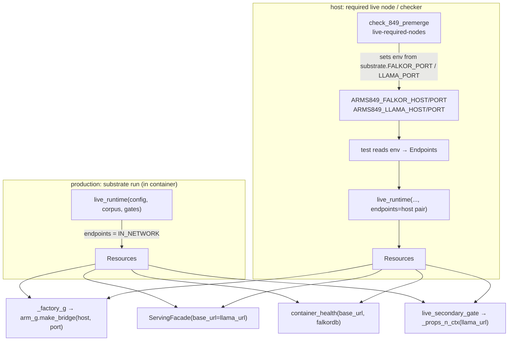

# Implementation Plan: #849 live runtime: host-reachable endpoints (#1083)

**Branch**: `kitty/mission-arms849-live-runtime-host-endpoints-01M7Q8F3` → merges into `feat/849-preconditions` | **Date**: 2026-11-18 | **Spec**: [spec.md](spec.md)
**Input**: Mission specification from `kitty-specs/arms849-live-runtime-host-endpoints-01M7Q8F3/spec.md`

## Planning Answers (Kent, 2026-11-18)

- **Endpoint carrier: option A** (decision `01M7Q8RGRANSNEQX84JP7JEAEB`). One endpoint pair is carried on the existing `Resources` record, defaulting to the in-network addresses, and read by arm G's bridge, the serving facade and the health check. Option B (separate keyword arguments per call) was rejected because three call sites could drift apart.
- **Engineering Alignment confirmed as stated**, points 1–7. They are carried into the Summary, the Design and the Implementation Concern Map below.

## Summary

The required live node `test_live_runtime_registers_g_d_r_with_one_embedder` fails from the host because `run_849_harness.live_runtime` reaches FalkorDB and llama.cpp only through the module constants `FALKORDB_ADDR = ("falkordb", 6379)` and `LLAMA_URL = "http://llama:8080"`. Those names resolve only inside the `arms849` compose network.

The fix makes the endpoints a value, not a constant. `live_runtime` gains a keyword-only `endpoints` parameter whose default is today's in-network pair. `Resources` carries the pair. Arm G's factory, the `ServingFacade` construction and `container_health` read it. Only the required live test and the FR-015 checker build a host pair, from the published substrate ports (`substrate.FALKOR_PORT = 16379`, `substrate.LLAMA_PORT = 18080`). The checker records the override environment, and `--verify` requires it.

## Technical Context

**Language/Version**: Python 3.12.3 (repository `.venv`)
**Primary Dependencies**: none added. Existing: `redis` (FalkorDB via arm G's bridge), the `urllib`/`socket` standard library (llama.cpp and FalkorDB health), and `pytest`.
**Storage**: N/A. The checker record is a JSON evidence file under `~/.local/share/kg-849-evidence/` or `build/849-runs/`, unchanged in format except for the added environment keys.
**Testing**: pytest. Unit tests in `tests/research/test_arms849_integration.py` (runtime and harness) and the checker's existing test module. The live node is gated on `ARMS849_LIVE=1`. The end-to-end proof is a real `check_849_premerge.py` run on office4.
**Target Platform**: office4 (Linux Mint 22.3, Strix Halo). The `arms849` compose stack is published on 127.0.0.1. office2 is not involved.
**Project Type**: single project (research harness under `scripts/research/`)
**Performance Goals**: N/A. No hot path changes; a connection target is passed through.
**Constraints**: C-001 (no production env override), C-002 (`ARMS849_LLAMA_HOSTS` stays forbidden and the allowlist stays a constant), C-003 (no move into the container), C-004 (an implementer agent writes the code).
**Scale/Scope**: about 4 production touch points in 2 files (`run_849_harness.py`, `check_849_premerge.py`) plus tests. `arm_g.make_bridge` already accepts `host`/`port`.

## Charter Check

*GATE: Must pass before Phase 0 research. Re-check after Phase 1 design.*

| Charter item | Assessment | Status |
|---|---|---|
| Testing Standards: pytest coverage for non-trivial Python | Every FR has a unit test. FR-006 is red-first, and the live node is the integration test. | Pass |
| Testing Standards: no dead code | `Endpoints` is consumed by `live_runtime`, the facade, health and arm G. The checker consumes the override constants. No new uncalled helper. | Pass (re-check at review) |
| Testing Standards: fixtures mirror real inputs | The verifier tests mutate a record shaped like the real run-3 checker record, not an invented one. | Pass |
| Quality Gates: integration verification, no-staging-aware | Form (a), a pre-merge live exercise: a real checker run on office4 against the live stack (SC-001, SC-002). It touches no office2 service. | Pass |
| Change-Risk Tier | Tier 3 (Python research scripts and tests). No host, network fabric, compose or service config change. Compose files are read, not modified. | Pass |
| Rebaseline Obligation | `scripts/research/**` and `tests/research/**` are not audited surfaces (`audited-surfaces.json`). Merge record: `Rebaseline: not required — research harness code on office4 only, no audited surface touched`. | Pass |
| Architecture docs standing requirement | No deployed service, credential, port, data flow or network topology changes. The ports already exist and are already published by the stack. No `docs/design/architecture/` update applies. | Pass |
| Constitution Directive 6 (deterministic vs stochastic) | Entirely deterministic wiring. No LLM-judgment step is introduced. | Pass |

Post-design re-check (after Phase 1): unchanged, all pass.

## Design



**D1. `Endpoints` value.** A frozen dataclass in `run_849_harness.py` with `falkordb: tuple[str, int]` and `llama_url: str`, plus the module constant `IN_NETWORK_ENDPOINTS = Endpoints(FALKORDB_ADDR, LLAMA_URL)`. The existing `FALKORDB_ADDR`/`LLAMA_URL` constants stay, as the source of the default. Their non-runtime users (`container_health`'s signature defaults, the host-phase gates environment at `:1283`) are untouched.

**D1a. The context-window probe follows the runtime (post-plan review P-1, 2026-11-18).** `_props_n_ctx` becomes `_props_n_ctx(base_url: str = LLAMA_URL)`. `Runtime` carries the `endpoints` it was built with. `live_secondary_gate(runtime, props_n_ctx=None)` resolves a `None` default to `lambda: _props_n_ctx(runtime.endpoints.llama_url)`. An explicitly injected `props_n_ctx` (existing tests) keeps working. Without this, a host runtime would send its completion to the host endpoint but probe `/props` in-network (`run_849_harness.py:1548-1550, 1677, 1695`).

**D2. `Resources.endpoints`.** `Resources` gains `endpoints: Endpoints = IN_NETWORK_ENDPOINTS`. That keeps every existing `Resources(...)` construction valid, including tests and fakes. `_factory_g` passes `host=resources.endpoints.falkordb[0], port=resources.endpoints.falkordb[1]` to `arm_g.make_bridge`. `_factory_d`/`_factory_r` are untouched because they make no network connections.

**D3. `live_runtime(config, corpus, gates_outcome, *, endpoints=IN_NETWORK_ENDPOINTS)`.** It builds `Resources(..., endpoints=endpoints)`, constructs `ServingFacade(config, tokenizer, endpoints.llama_url, ...)`, and sets `health=lambda: container_health(config, endpoints.llama_url, endpoints.falkordb)`. It reads no environment variable for endpoints (C-001).

**D4. Test-side override reader.** A small helper in the test module, `_host_endpoints_from_env()`, reads `ARMS849_FALKOR_HOST` (default `127.0.0.1`), `ARMS849_FALKOR_PORT` (default the substrate's `FALKOR_PORT`), `ARMS849_LLAMA_HOST` (default `127.0.0.1`) and `ARMS849_LLAMA_PORT` (default the substrate's `LLAMA_PORT`), and returns `Endpoints`. A non-integer port raises at setup with the variable named (spec edge case). The defaults are host defaults, never the in-network names (spec edge case: only one override set). This mirrors the existing `falkor_endpoint` fixture convention in `test_arms849_arm_g.py`.

**D5. Checker.** In `check_849_premerge.py`, the `live-required-nodes` env adds `ARMS849_FALKOR_HOST=127.0.0.1`, `ARMS849_FALKOR_PORT=str(substrate.FALKOR_PORT)`, `ARMS849_LLAMA_HOST=127.0.0.1` and `ARMS849_LLAMA_PORT=str(substrate.LLAMA_PORT)`. The `_step` evidence-environment allowlist (currently `PYTHONHASHSEED`, `ARMS849_CACHE`, `ARMS849_LIVE`, `PYTHONPATH`, at line ~275) adds those four keys, so the record shows them (FR-004).

**D6. Verifier.** In `--verify`'s `required_live` semantics, beyond `ARMS849_LIVE == "1"`, it also requires the four override keys to equal the published values derived from the same constants (FR-005). One shared constant mapping (`HOST_LIVE_ENDPOINT_ENV`) is used by both D5 and D6, so the writer and the checker cannot drift.

**D7. Allowlist untouched (C-002).** `serving.ALLOWED_HOSTS` already contains `127.0.0.1`, so no change is needed. `ARMS849_LLAMA_HOSTS` stays unread. An existing test already asserts that.

### Test plan (non-vacuity, per tactic acceptance-criteria-non-vacuity)

| Test | Proves | Shape |
|---|---|---|
| T-a `live_runtime` default pair | FR-002 [ratchet] | Uses the **real** `ARM_FACTORIES`/`_factory_g`, patched only at the `arm_g.make_bridge` boundary (capturing `host`/`port`), with fake tokenizer and embedder. It **invokes** the returned `facade(...)` and `health()` callbacks, plus `live_secondary_gate`'s resolved props probe, against patched `urlopen`/`socket.create_connection` that capture their targets. It asserts that all four consumers target `falkordb:6379` and `http://llama:8080`. (Post-plan review P-2: faking the factories or only constructing the callbacks would bypass the wiring under test.) |
| T-b explicit pair, same fixture | FR-001 [build], the positive control for T-a | The same fixture with `endpoints=Endpoints(("127.0.0.1",16379),"http://127.0.0.1:18080")`. The bridge, facade, health and props probe all see the host pair. |
| T-c env is ignored by production | C-001 | **Fresh process** (P-3): a subprocess sets all four `ARMS849_*` overrides to values distinct from every default **before importing** the harness. It wraps `os.environ` with a read-recording mapping, imports the harness, builds the default runtime through the same patched boundaries as T-a, and asserts (i) the in-network pair everywhere and (ii) **zero reads** of the four keys during import and construction. T-b is its positive control. A planted read in a fake must make (ii) fail, which is checked once at review. |
| T-d override reader | FR-003, edge cases | Defaults, a partial override (the other side stays on the host default, never the in-network name), and a non-integer port raising with the variable named. |
| T-e red-first | FR-006 | **Not live-gated** (P-6). The real `live_runtime` with no override, from the host, asserts the failure is a **name-resolution** error naming `falkordb`, not some other setup or connection error. It skips only when `socket.getaddrinfo("falkordb", 6379)` succeeds (the precondition is false) or the model cache is absent (fresh-worktree CI). So it runs in both office seed suites of the checker. It is bounded by a hard per-test timeout, because the bridge sets `socket_connect_timeout=None` (`arm_g.py:1398`); production transport is unchanged. |
| T-f checker env | FR-004 | Fake runner. It asserts **both** the env actually passed to the runner **and** the recorded `environment`, against an **independent oracle**: the literal `127.0.0.1` and `substrate.FALKOR_PORT`/`LLAMA_PORT`, never `HOST_LIVE_ENDPOINT_ENV` itself (P-5). |
| T-g verifier | FR-005, SC-003 | One real-shaped record fixture: the well-formed record is accepted; without `ARMS849_LIVE` it is rejected; for **each of the four keys independently**, absent is rejected and wrong value is rejected (parametrized); and a legacy-shaped same-commit record lacking all four keys is rejected (P-5). |
| Live node (existing, extended) | SC-001 | It calls `live_runtime(..., endpoints=_host_endpoints_from_env())` and additionally calls `runtime.health()` for real, opting out of the autouse `_block_live_http` guard the way the `live_http` fixture in `test_arms849_arm_g.py:41-44` does (P-2). So the llama side is exercised live, not only FalkorDB. |
| Half-by-half | FR-001 compound | The reviewer reverts each of the four wirings alone (bridge, facade, health, props probe). T-b must go red each time. |

### Post-plan review dispositions (Codex, `codex exec` read-only, 2026-11-18, verdict REVISE)

Reviewer: Codex CLI 0.170.0, model `gpt-6.1-sol`. Implementer of this plan's code: python-pedro (Claude). Cross-vendor independence holds. Raw verdict: `~/.local/share/kg-849-evidence/1083/post-plan-codex-verdict.md`.

| # | Finding | Severity | Disposition |
|---|---|---|---|
| P-1 | `live_secondary_gate`'s default `_props_n_ctx` hard-wires `LLAMA_URL` | MAJOR | **Adopted**: D1a, and T-a/T-b cover it |
| P-2 | Tests could bypass the real `_factory_g`; lazy callbacks never invoked; live node never touches llama | MAJOR | **Adopted**: T-a rewritten, live node extended |
| P-3 | T-c misses import-time env reads | MAJOR | **Adopted**: fresh-process T-c with read recording |
| P-4 | `--verify` accepts internally contradictory records (non-zero counts, non-executing pytest command token tricks) | MAJOR (Codex) | **Not adopted in this mission; surfaced to Kent for a ruling.** Verified: `valid_step` already requires `returncode == 0`, `passed is True` and `status == "pass"` (`check_849_premerge.py:612`), and `nodes_valid` requires every required node to have passed. So a genuine failed or skipped run cannot verify. The residue is hardening against tampered or self-contradictory records, which predates #1083. **Ruling (Kent, 2026-11-18): option B, a separate issue, filed as kentonium3/kg-automation#1106. Out of scope here.** |
| P-5 | Shared map as its own oracle; per-key coverage; legacy records | MINOR | **Adopted**: T-f/T-g |
| P-6 | Red-first test never scheduled; connect timeout is `None` | MINOR | **Adopted**: T-e de-gated, precondition-skipped, hard timeout |

## Project Structure

### Documentation (this mission)

```
kitty-specs/arms849-live-runtime-host-endpoints-01M7Q8F3/
├── plan.md              # This file
├── research.md          # Phase 0 output
├── data-model.md        # Phase 1 output
├── quickstart.md        # Phase 1 output (live verification procedure)
└── tasks.md             # Phase 2 output (/spec-kitty.tasks, not created here)
```

No `contracts/`. The mission defines no external interface (`meta.json`: `"contracts": "none"` with rationale).

### Source Code (repository root)

```
scripts/research/
├── run_849_harness.py          # D1–D3: Endpoints, Resources.endpoints, live_runtime(endpoints=)
├── check_849_premerge.py       # D5–D6: live-required-nodes env, evidence allowlist, verifier
└── arms849/
    ├── arm_g.py                # read only: make_bridge(host=, port=) already exists
    ├── serving.py              # read only: ALLOWED_HOSTS already includes 127.0.0.1 (C-002)
    └── substrate.py            # read only: FALKOR_PORT / LLAMA_PORT are the published-port source

tests/research/
├── test_arms849_integration.py # T-a..T-e and the live node's override wiring
└── test_check_849_premerge.py  # T-f, T-g (existing checker test module)
```

**Structure Decision**: the existing single-project research layout. No new modules.

## Complexity Tracking

No charter violations.

## Implementation Concern Map

> Implementation concerns are NOT work packages. `/spec-kitty.tasks` decides the WP split.

### IC-01 — Runtime endpoint wiring

- **Purpose**: Make the live runtime's FalkorDB and llama targets a value with in-network defaults, consumed consistently by the bridge, facade and health.
- **Relevant requirements**: FR-001, FR-002, FR-003, FR-006, C-001, C-002, NFR-001
- **Affected surfaces**: `scripts/research/run_849_harness.py` (`Endpoints`, `IN_NETWORK_ENDPOINTS`, `Resources`, `Runtime.endpoints`, `_factory_g`, `live_runtime`, `_props_n_ctx`, `live_secondary_gate`), `tests/research/test_arms849_integration.py`
- **Sequencing/depends-on**: none
- **Risks**: missing one of the three consumers (the half-by-half check covers it). A `Resources` default change breaks fakes that construct it positionally (keep the field last, with a default). T-e must not hang. The bridge's connect timeout is `None` (`arm_g.py:1398`), so the test carries its own hard timeout (P-6), and production transport is not changed to suit a test.

### IC-02 — Checker records and verifier requires the host endpoints

- **Purpose**: Have the FR-015 checker drive the live node at the published ports, record that in the evidence, and refuse records that lack it.
- **Relevant requirements**: FR-004, FR-005, NFR-002, SC-001–SC-003
- **Affected surfaces**: `scripts/research/check_849_premerge.py` (`live-required-nodes` env, `_step` evidence allowlist, `--verify` `required_live` semantics, shared `HOST_LIVE_ENDPOINT_ENV`), the checker's test module
- **Sequencing/depends-on**: IC-01 for the end-to-end live proof only. The unit tests are independent.
- **Risks**: the evidence allowlist silently dropping the keys (T-f asserts on the recorded environment, not only on the env passed). Older records (run 3 at a5550894) will no longer verify. That is intended, since records are commit-bound.

## Live Verification (charter Quality Gate, form a)

After the mission merges into `feat/849-preconditions`, run `check_849_premerge.py` on office4 at that commit (procedure in [quickstart.md](quickstart.md)). Acceptance is SC-001–SC-003. The record then goes into `spec-kitty agent acceptance-verdict` for `arms-preconditions-01M3FVRY#FR-015`. That step belongs to the preconditions mission's close-out, which is out of scope here.
