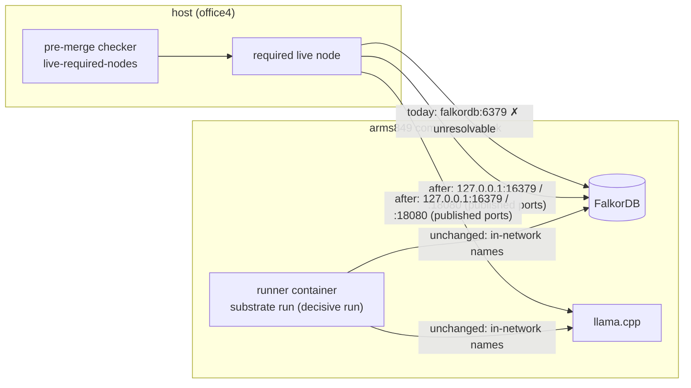

# Mission Specification: #849 live runtime: host-reachable endpoints (#1083)

**Mission Branch**: `kitty/mission-arms849-live-runtime-host-endpoints-01M7Q8F3` (merges into `feat/849-preconditions`)
**Created**: 2026-11-18
**Status**: Draft
**Input**: kentonium3/kg-automation#1083 (spec: ready), fix A as chosen by Kent on 2026-10-26; Intent Summary confirmed by Kent on 2026-11-18 (decision 01M7Q8GBPFDGP9H1CC2DAQNETZ).

## Context

The #849 decisive test compares graph memory, vector-RAG and full-corpus baselines over Kent's scenario arcs, on local inference on office4. It is blocked behind its preconditions mission (`arms-preconditions-01M3FVRY`, #1023). That mission's merge to main is held on arms-preconditions-01M3FVRY#FR-015, the commit-bound pre-merge checker record. The checker passes 10 of 12 steps. One of the two remaining blockers (live-down) was cleared on 2026-11-03. The other is this one. The required live node `test_live_runtime_registers_g_d_r_with_one_embedder` can never pass from the host, because the live runtime knows only the compose-network service names (`falkordb:6379`, `http://llama:8080`), and those do not resolve outside the network.

## User Scenarios & Testing *(mandatory)*

### User Story 1 - The pre-merge checker's required live nodes pass from the host (Priority: P1)

Kent (or an agent on his behalf) runs the arms-preconditions-01M3FVRY#FR-015 pre-merge checker on office4 against the live `arms849` stack. The stack publishes FalkorDB and llama.cpp on 127.0.0.1. The checker's `live-required-nodes` step runs both required live nodes as host pytest, and both pass.

**Why this priority**: This is the only remaining arms-preconditions-01M3FVRY#FR-015 blocker. Without it, #1023 cannot merge to main and the #849 decisive run cannot start.

**Independent Test**: Run the checker at the fix commit and read the `live-required-nodes` step of the record. It shows a pass with 2 of 2 nodes passing.

**Acceptance Scenarios**:

1. **Given** the live `arms849` stack is up with its published host ports, **When** the checker runs `live-required-nodes`, **Then** both required nodes pass and the step records the host endpoints it used.
2. **Given** a host run of the live-runtime node with no endpoint override, **When** it builds the runtime, **Then** it fails resolving the in-network FalkorDB name. This is the red-first demonstration that the override is what makes it pass.

---

### User Story 2 - The decisive run inside the container is unchanged (Priority: P1)

The decisive run executes inside the runner container through `substrate run`, and it keeps reaching FalkorDB and llama.cpp by their in-network names. Nothing in the environment can redirect the pre-registered run's endpoints.

**Why this priority**: The #849 rubric is pre-registered. A change that let an environment variable silently redirect the run's inference or graph endpoints would undermine the run's integrity.

**Independent Test**: Build the runtime with no endpoints and confirm it targets the in-network addresses. Then confirm that the in-container `live-smoke` checker step still passes.

**Acceptance Scenarios**:

1. **Given** the runtime is built with no explicit endpoints, **When** it connects, **Then** every connection uses `falkordb:6379` and `http://llama:8080`.
2. **Given** override environment variables are set in the process, **When** the production harness builds its runtime, **Then** it ignores them. Only the test and the checker read overrides.

---

### User Story 3 - The record verifier stays strict (Priority: P2)

The checker's `--verify` mode accepts a record only when its `live-required-nodes` step ran live, with `ARMS849_LIVE=1` and the host endpoint overrides equal to the published ports.

**Why this priority**: A verifier that merely tolerated the new environment would accept a record whose live step silently fell back to the in-network names.

**Independent Test**: Verify three records built from one fixture: one well-formed, one missing `ARMS849_LIVE=1`, and one missing or carrying wrong overrides. Only the well-formed one is accepted.

**Acceptance Scenarios**:

1. **Given** a record whose live step carries `ARMS849_LIVE=1` and the published-port overrides, **When** it is verified, **Then** it is accepted.
2. **Given** the same record without `ARMS849_LIVE=1`, **When** it is verified, **Then** it is rejected.
3. **Given** the same record with the overrides absent or not equal to the published ports, **When** it is verified, **Then** it is rejected.

### Edge Cases

- Only the FalkorDB override is set: the llama override falls back to its own host default and never to the in-network name. A test pins this.
- An override port that is not an integer fails loudly at test setup, not as a confusing connection error.
- The llama host allowlist already contains `127.0.0.1`, so a host override must not need, and must not trigger, any allowlist change.
- The health check used by the runtime must probe the same endpoints the runtime uses, or a host run would report the stack unhealthy while it is reachable.

## Requirements *(mandatory)*

### Functional Requirements

| ID | Title | User Story | Priority | Status | Delivery | No-op passable? |
|----|-------|------------|----------|--------|----------|-----------------|
| FR-001 | Live runtime accepts explicit endpoints | As the checker, I want the live runtime to accept an explicit FalkorDB endpoint and llama endpoint, and to use them for every connection the returned runtime makes (graph arm bridge, serving facade, health check), so that a host run reaches the published ports. | High | Open | [build] | no |
| FR-002 | Defaults remain the in-network addresses | As the decisive run, I want a runtime built with no endpoints to use `falkordb:6379` and `http://llama:8080`, exactly as today, so that in-container runs are unchanged. | High | Open | [ratchet] | yes — paired with FR-001's explicit-endpoint assertion on the same runtime-construction fixture as its positive control |
| FR-003 | Required live node reads host overrides | As the checker, I want the required live-runtime node to read `ARMS849_FALKOR_HOST`/`ARMS849_FALKOR_PORT` (the existing convention) and `ARMS849_LLAMA_HOST`/`ARMS849_LLAMA_PORT`, and pass them to the runtime, so that it runs against the stack from the host. | High | Open | [build] | no |
| FR-004 | Checker passes and records the published ports | As the arms-preconditions-01M3FVRY#FR-015 record, I want the `live-required-nodes` step to set the overrides to the substrate's published FalkorDB and llama ports (taken from the substrate's constants, not repeated literals) and to record them in the step's evidence environment, so that the record shows what the live step targeted. | High | Open | [build] | no |
| FR-005 | Verifier requires the overrides | As the arms-preconditions-01M3FVRY#FR-015 gate, I want `--verify` to accept a record only when its `live-required-nodes` environment carries `ARMS849_LIVE=1` and overrides equal to the published ports, and to reject it otherwise, so that a silent fallback cannot verify. | High | Open | [build] | no |
| FR-006 | Red-first override demonstration | As a reviewer, I want a test showing that a host run with no override fails resolving the in-network FalkorDB name, so that the override is proven to be what makes the host run pass. | Medium | Open | [build] | no |

### Non-Functional Requirements

| ID | Title | Requirement | Category | Priority | Status |
|----|-------|-------------|----------|----------|--------|
| NFR-001 | Research suite stays green | The full `tests/research` suite has 0 failures at the fix commit, with no previously passing test newly skipped. | Reliability | High | Open |
| NFR-002 | In-container run unregressed | The checker's `live-smoke` step (in-container `substrate run -- --smoke`) passes at the fix commit, and `live-down` completes cleanly. | Reliability | High | Open |

### Constraints

| ID | Title | Constraint | Category | Priority | Status |
|----|-------|------------|----------|----------|--------|
| C-001 | No production environment override | Only the test and the checker read the endpoint override variables. The production harness and the arm factories read no new environment variables, so the pre-registered run's endpoints cannot be redirected through the environment. | Technical | High | Open |
| C-002 | Allowlist untouched | The llama host allowlist stays a constant. `ARMS849_LLAMA_HOSTS` stays unread and forbidden, as WP01 of #1023 established. | Technical | High | Open |
| C-003 | Option B stays rejected | The required nodes are not moved into the runner container. They stay host pytest (Kent, 2026-10-26). | Business | High | Open |
| C-004 | Lead does not implement | Code is written by an implementer agent (python-pedro). The orchestrating session designs, dispatches and decides. | Business | Medium | Open |

### Key Entities

- **Endpoint pair**: the FalkorDB host and port plus the llama base URL that a live runtime connects to. There are two sources: the in-network defaults (production) and host overrides (test and checker only).
- **Checker record**: the commit-bound arms-preconditions-01M3FVRY#FR-015 evidence file. Its `live-required-nodes` step carries the environment the live nodes ran under.

## Success Criteria *(mandatory)*

### Measurable Outcomes

- **SC-001**: A checker run at the fix commit records `live-required-nodes` as passed, with 2 of 2 required nodes passing. — [build] · no-op passable: no
- **SC-002**: The same run records `live-smoke` passed and `live-down` clean, so every checker step passes and arms-preconditions-01M3FVRY#FR-015 becomes recordable. — [build] · no-op passable: no
- **SC-003**: `--verify` accepts the run's record and rejects both mutated copies (no `ARMS849_LIVE=1`; wrong or absent overrides). — [build] · no-op passable: no

## Assumptions

- The `arms849` stack keeps publishing FalkorDB on 127.0.0.1:16379 and llama.cpp on 127.0.0.1:18080, as the substrate's port constants define.
- `substrate setup` state from 2026-10-23 (`build/849-runs/setup.json`, verified GGUF, pinned FalkorDB digest) is still valid on office4. If it is not, the checker run (not this mission's code) re-establishes it.
- The llama override is named `ARMS849_LLAMA_HOST`/`ARMS849_LLAMA_PORT` to mirror the FalkorDB convention (assumption shown to Kent in the Intent Summary and confirmed).

## Out of Scope

- Recording arms-preconditions-01M3FVRY#FR-015, merging `feat/849-preconditions` to main, and the 72-cell decisive run. These follow this mission and are tracked on #1023 and #849.
- The `kga-try` project name in generated orientation banners on main. It is unrelated to this code path.
