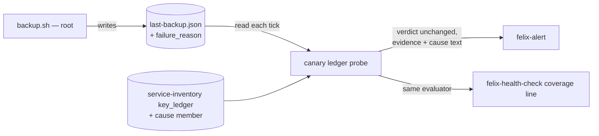

# Implementation Plan: Backup alerts name why the run failed

**Branch**: `fix/backup-failure-cause-in-alert` | **Date**: 2026-10-15 | **Spec**: [spec.md](spec.md)
**Input**: Mission specification from `kitty-specs/backup-failure-cause-in-alert-01M502K3/spec.md` (kentonium3/kg-automation#1067)

## Summary

The backup script records **why** a fatal run failed as a closed cause code, `failure_reason`, in its state pointer. The `restic-backup` key ledger declares that key `diagnostic_only`. It also gains a new optional member, `cause`, which says *which* key carries a cause and the plain-words text for each code. When the canary's ledger evaluation produces a non-ok verdict, it appends the declared text to the evidence. felix-health-check reuses `health.evaluate`, so its coverage line inherits the text with no code of its own. Health, freshness and dedup are untouched. The cause is never compared against anything that decides a verdict.



## Technical Context

**Language/Version**: Python 3.12 (canary, health-check, validator, tests); bash (`scripts/office2/restic-backup.sh`)
**Primary Dependencies**: stdlib only; existing `scripts/canary` evaluator; `tooling/scripts/validate_architecture_data.py`
**Storage**: the JSON state pointer `/data/services/backup/state/last-backup.json`; the declaration lives in `docs/design/architecture/data/service-inventory.json`
**Testing**: pytest. The existing stub harness executes `restic-backup.sh` under non-root overrides (`tests/office2/restic_backup/`). Canary and health-check unit tests use fixtures. Validator rule tests are in `tests/architecture/test_key_ledger_rules.py`.
**Target Platform**: office2 (Ubuntu 24.04). The canary and health-check run from the `/home/claude/kg-automation` checkout.
**Project Type**: single repo, operations scripts
**Performance Goals**: n/a (one dict lookup per evaluation)
**Constraints**: C-001 (no root-to-claude code edge), C-002 (the backup script is installed by hand), C-003 (declared, not keyed on the component name), C-004 (diagnostic-only), NFR-002 (cause text ≤ 120 chars, declared text only)
**Scale/Scope**: about 5 source files, 1 inventory entry, 1 contract amendment, runbook prose

## Charter Check

- **Deterministic vs stochastic (Directive 6)**: all deterministic code; no agent prompt involved. Pass.
- **Engineering principle 14 (verified-false vs could-not-check)**: the cause only decorates a verdict that has already been decided. It never turns `unknown` into anything else. Pass.
- **Engineering principle 10 (guardrails)**: the new ledger member is closed by validator rules, so a malformed declaration cannot merge. Pass.
- **Change-risk tier**: Tier 3 (Python and bash logic plus inventory metadata). No Tier 0 action. The live `backup.sh` install is Kent's existing manual operator handoff. Pass.
- **Rebaseline obligation (#557)**: `audited-surfaces.json` matches none of `scripts/office2/restic-backup.sh`, `scripts/canary/**`, `scripts/office2/felix_health_check/**` or the inventory (verified 2026-10-15). The merge commit records `Rebaseline: not required — no audited surface touched`. Pass.
- **Architecture-doc standing requirement**: no service, credential, port or data flow changes. The data-flow content of the pointer gains a key, so `service-inventory.json` (ledger and note) and `restic-backup-ops.md` are updated in the same merge. `signal-to-doc-map.json` change class: none of the mission-architecture-impact classes apply beyond the runbook-modified class (`runbook-modified`). Its doc targets are reviewed in the docs work.

## Project Structure

### Documentation (this mission)

```
kitty-specs/backup-failure-cause-in-alert-01M502K3/
├── spec.md, plan.md, research.md, data-model.md, quickstart.md
├── contracts/key-ledger-cause-member.md   # amendment to the key-ledger contract
└── tasks.md + tasks/                        # /spec-kitty.tasks
```

### Source Code (repository root)

```
scripts/office2/restic-backup.sh                       # FAILURE_REASON + trap classification
scripts/canary/probes.py                               # enrich non-ok ledger verdicts with declared cause text
scripts/canary/ledger.py                               # (read-only helper for the cause member, if cleaner there)
tooling/scripts/validate_architecture_data.py          # KEY_LEDGER_MEMBERS += cause; rule 9 shape checks
docs/design/architecture/data/service-inventory.json    # restic-backup: diagnostic_only.failure_reason + cause member; note/updated_by
kitty-specs/pointer-key-ledger-01M189P6/contracts/key-ledger.md  # dated amendment (rule 1 + rule 9), add-only
docs/runbooks/restic-backup-ops.md                     # cause codes + operator action per code
tests/office2/restic_backup/test_pointer_emission.py   # FIFTEEN keys; one cause per fatal exit; null on completion
tests/office2/restic_backup/test_ledger_reconciliation.py
tests/canary/test_*                                    # enrichment, fail-safe, verdict invariance
tests/office2/felix_health_check/test_*                # coverage line carries cause
tests/architecture/test_key_ledger_rules.py            # rule 9
```

**Structure Decision**: extend the existing seams in place. No new modules unless a small pure helper (`cause_text(pointer, ledger) -> str | None`) reads more cleanly in `scripts/canary/ledger.py`.

## Implementation Concern Map

### IC-01 — Producer records the cause
- **Purpose**: `backup.sh` writes `failure_reason` on every exit: a code on each fatal exit, `"unclassified"` on any other non-zero exit, and `null` on completion.
- **Relevant requirements**: FR-001, FR-002, FR-003, NFR-003, C-001, C-002
- **Affected surfaces**: `scripts/office2/restic-backup.sh`; `tests/office2/restic_backup/*`; the inventory `diagnostic_only` entry (needed in the same change, or the reconciliation harness goes red)
- **Sequencing/depends-on**: none
- **Risks**: the trap must capture `$?` as its first statement, or the classification reads the wrong status. The value is emitted as a JSON string literal from a fixed vocabulary only, never interpolated from command output. `schema_version` stays 2 (research R2).

### IC-02 — Ledger `cause` member and validator rule
- **Purpose**: a closed, validated declaration of which key carries a cause and the text for each code.
- **Relevant requirements**: FR-004, C-003, C-004, NFR-002
- **Affected surfaces**: `validate_architecture_data.py`, `test_key_ledger_rules.py`, the inventory `cause` member, the contract amendment
- **Sequencing/depends-on**: IC-01 (declares `failure_reason` in `diagnostic_only`, which rule 9 requires)
- **Risks**: the contract is closed by design (rule 1). Amend it explicitly, add-only and dated, never silently.

### IC-03 — Canary and health-check enrichment
- **Purpose**: a non-ok verdict from a ledger-backed pointer carries the declared cause text. The verdict and dedup are unchanged.
- **Relevant requirements**: FR-005, FR-006, FR-007, FR-008, NFR-001, NFR-002
- **Affected surfaces**: `scripts/canary/probes.py` (`_probe_freshness_with_ledger`, every non-ok return); tests for the canary and health-check
- **Sequencing/depends-on**: IC-02
- **Risks**:
  - The enrichment must not run on ok verdicts, and must not alter `ok`, `stale`, `evaluable` or `signal`.
  - A raw pointer value must never reach the text; an unknown string yields only a fixed marker.
  - The canary evaluator must not depend on the validator having run. A malformed `cause` member at runtime must be ignored safely.

### IC-04 — Operator docs
- **Purpose**: `restic-backup-ops.md` lists every code with its action; the inventory note says fifteen keys; `updated_by` records the mission.
- **Relevant requirements**: FR-009
- **Affected surfaces**: `docs/runbooks/restic-backup-ops.md`, inventory prose; possibly `service-inventory.md` and `observability-and-alerting.md` where they describe the ledger members
- **Sequencing/depends-on**: IC-01, IC-02
- **Risks**: a docs test pins every declared code into the runbook (FR-009 non-vacuity).

## Deploy and live verification

- **No manifest.** The canary and felix-health-check execute from the office2 checkout each tick, and the inventory is read repo-relative, so felix-deployer's pull of `main` is the deploy. No unit or audited surface changes, so no rebaseline is expected.
- **Live check after the pull**:
  1. The next canary tick evaluates `restic-backup` with the same outcome as before, and there is no `tick_error`.
  2. A read-only, in-memory evaluation on office2, as `claude`, of a synthetic not-mounted pointer against the live inventory shows the cause text.
  3. Run a felix-health-check service once, or wait for 23:00, and confirm the coverage line is unchanged for today's real pointer.
- **Operator handoff (outstanding by design, C-002)**: Kent installs the new `backup.sh` by hand per `restic-backup-ops.md`. Until then, `backup-script-drift` reports `drift`, which is expected, and alerts read exactly as today. The mission records this as outstanding, not done.

## Complexity Tracking

None.
