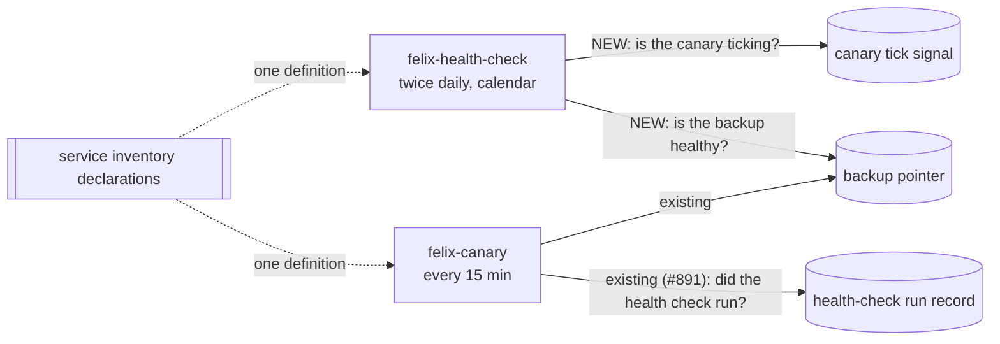

# Mission Specification: Canary dead-man's switch and backup coverage in felix-health-check

**Mission Branch**: `fix/canary-deadman-backup-coverage`
**Created**: 2026-10-14
**Status**: Draft
**Input**: kentonium3/kg-automation#1063 (spec-ready body, 2026-10-14). Discovery minimized on Kent's instruction ("proceed with #1063 on your own", 2026-10-14). See decision `DM-01M4XVYKP0998SAA02GFY4F16M`. The scenario and assumptions below are derived from the issue and recorded here instead of a confirmed interview.

## Intent Summary

- **Primary actor**: Kent, the only human operator. He learns about trouble from a `felix-alert` push.
- **Trigger**: the twice-daily `felix-health-check` run (11:00 and 23:00 UTC; it also catches up after downtime).
- **Desired outcome**: if the canary has stopped running, or the backup has stopped producing healthy snapshots, that run says so and Kent gets an alert. The health check never again reports "all healthy" while either condition holds.
- **Invariant**: "all healthy" is an affirmative verdict. It requires every check, including these two, to have been evaluated *and* to have passed. If a check cannot be evaluated, the run alerts as unknown; it never counts as healthy (engineering principle 14).
- **Boundary**: there is one definition of "the backup is healthy" and one definition of "the canary is alive": the declarations the canary already uses in the service inventory. The health check is a second *observer* of those definitions, not a second author of them.

## Background

From 2026-09-27 to 2026-10-14 all 17 nightly backups failed (backup drive not mounted). The canary is the only component that watches backup freshness, and it had silently stopped running (#1062). The health check, which kept running, reported "all healthy" 34 times, because its underlying script checks neither backups nor the canary. That script lives only on the host, outside version control, so nothing in the repo revealed the gap.

The reverse watch already exists: the canary checks that the health check ran (#891). This mission adds the missing direction, so each watcher watches the other.

## User Scenarios & Testing *(mandatory)*

### User Story 1 - The canary goes dark and Kent is told (Priority: P1)

The canary stops running for any reason: a dormant timer, a crash loop, a disabled unit, or a host that came back without it. At the next health-check run Kent receives an alert that names the canary as not ticking and gives the age of its last tick.

**Why this priority**: the canary watches everything else, including backups. Without a watcher on the canary, every other check it owns can fail silently. This is the gap that made the 17-day outage possible.

**Independent Test**: point the health check at a canary tick signal older than the canary's declared bound, run it, and observe a non-healthy verdict and an alert. With a fresh tick signal, the same fixture yields no canary finding.

**Acceptance Scenarios**:

1. **Given** the canary's last successful tick is older than its declared freshness bound, **When** the health check runs, **Then** the verdict is "failures detected", the evidence names the canary and the tick's age, and an alert is emitted.
2. **Given** the canary tick signal is missing, unreadable, or reports a non-success status, **When** the health check runs, **Then** the verdict is not healthy ("failures detected" for an explicit failure, "unknown" for unreadable) and an alert is emitted.
3. **Given** the canary ticked within its bound and reported success, **When** the health check runs with everything else healthy, **Then** the verdict is "all healthy" and no alert is sent.

---

### User Story 2 - Backups stop and Kent is told even if the canary is also dark (Priority: P1)

The backup fails for any reason: drive missing, restic error, no snapshot, or a stale snapshot. The health check reports it from its own read of the backup pointer, judged by the same rules the canary uses. This works whether or not the canary is running.

**Why this priority**: backup failure is the data-loss risk. A second independent path means backup monitoring no longer has a single point of failure.

**Independent Test**: give the health check a backup pointer recording the 2026-09-27→10-14 failure shape (exit code 127, stale snapshot), run it, and observe "failures detected". Give it the 2026-10-14 15:30 healthy pointer, and the backup finding is absent.

**Acceptance Scenarios**:

1. **Given** the backup pointer records a failed run (an exit code outside the declared good set, e.g. 127), **When** the health check runs, **Then** the verdict is "failures detected" and the evidence names the failing key and value.
2. **Given** the backup's last snapshot is older than the declared bound, **When** the health check runs, **Then** the verdict is "failures detected" with the snapshot's age.
3. **Given** any pointer document, **When** both the health check and the canary judge it, **Then** they reach the same healthy/unhealthy/unknown decision.

---

### User Story 3 - The health-check script is tracked, reviewed and deployed like everything else (Priority: P2)

The service-level checks the health check already performs live in the repo, change through review and CI, and reach the host through the deploy pipeline. The untracked host copy is retired.

**Why this priority**: the coverage gap went unnoticed because the script was invisible to the repo. This story prevents the same blind spot from recurring, but it does not by itself detect anything new.

**Independent Test**: after deploy, the health check runs the repo-tracked script. The previous untracked host copy no longer exists, and the run's verdict for the existing service checks is unchanged.

**Acceptance Scenarios**:

1. **Given** the mission is deployed, **When** the health check runs, **Then** it executes the version-controlled script from the deployed checkout, not a host-only copy.
2. **Given** the deploy has completed, **When** the host is inspected, **Then** the untracked copy is absent and nothing else references it.

### Edge Cases

- **Coverage check cannot run.** The inventory is unreadable, the canary or backup declaration is missing, or the shared evaluator cannot be loaded. The verdict is "unknown" (which alerts), never "all healthy", and the wrapper still writes its run record and still exits 0. A crash would end as a silent systemd failure, because the unit has no failure hook.
- **Both checks fail at once** (this incident): one alert lists both findings.
- **The canary ticks but does nothing** (status missing or non-success, zero components evaluated, completion time unusable): not alive (FR-011).
- **A declaration loses its freshness bound**: unknown, never healthy (FR-012).
- **The service checks fail and a coverage check fails**: one alert lists everything. Failure wins over unknown, as it already does in the classification.
- **Catch-up run right after downtime**: the canary did not run during the outage, so its tick is legitimately stale and the run alerts. This is accepted as true and informative, not a false positive (see Assumptions). A grace window is explicitly rejected, because it would hide a canary that is dead from boot, which is the #1062 failure mode.
- **Future-dated or unparseable timestamps**: handled by the shared evaluator's existing rules (future skew beyond tolerance counts as stale; an unparseable anchor is unhealthy). The health check inherits these rules and does not reimplement them.
- **The canary is alive and also alerting on the backup**: Kent may get the backup failure from both watchers. That is accepted redundancy. The health check alerts at most twice a day, and the two alerts come from distinct, labeled sources.

## Requirements *(mandatory)*

### Functional Requirements

| ID | Title | User Story | Priority | Status | Delivery | No-op passable? |
|----|-------|------------|----------|--------|----------|-----------------|
| FR-001 | Canary liveness check | As Kent, I want each health-check run to judge whether the canary is still ticking, against the canary's own declared freshness bound, so that a dark canary produces an alert within one health-check cycle. | High | Open | [build] | no: a stale-tick fixture must flip the verdict from healthy to failures-detected, with a fresh-tick positive control on the same fixture |
| FR-002 | Backup health check | As Kent, I want each health-check run to judge the backup pointer against the backup's declared health rules (the full declared key ledger, including freshness), so that failed or stale backups alert even while the canary is dark. | High | Open | [build] | no: a 127/stale fixture must flip the verdict, with the real 2026-10-14 healthy pointer as the same-fixture positive control |
| FR-003 | One definition of health | As a maintainer, I want the health check's canary and backup verdicts to come from the same declarations and the same evaluator the canary uses, so that the two watchers can never disagree about what "healthy" means. | High | Open | [build] | no: an agreement test over a corpus of documents fails if the two paths diverge on any of them |
| FR-004 | Fail closed on inability to check | As Kent, I want any inability to evaluate a coverage check (unreadable inventory, missing declaration, evaluator unavailable, unevaluable probe) to produce an "unknown" verdict that alerts, so that "all healthy" is never issued for a check that did not run. | High | Open | [build] | no: each inability fixture must yield unknown, never all-healthy, and a well-formed fixture is the positive control |
| FR-005 | Combined verdict and evidence | As Kent, I want one run to produce a single verdict covering the existing service checks and both new checks. Failure wins over unknown, which wins over healthy. The alert I receive must show each coverage finding with its evidence, even when the shell output is long, and show a missing script first. | High | Open | [build] | no: a run with long shell output, a failing service check and a stale canary must show both findings in the rendered alert |
| FR-006 | Run record stays compatible | As a maintainer, I want the run record the canary already reads (status, ran-at, exit code, delivery) to keep its existing keys and status vocabulary, so that the canary's existing watch on the health check (#891) keeps working unchanged. | High | Open | [ratchet] | yes, so it is paired with FR-001's fixture: the record written by a failing coverage run must still be judged healthy-runner by the canary's existing probe |
| FR-007 | Script under version control | As a maintainer, I want the shell health-check script tracked in the repo and run from the deployed checkout, with its stale "called by OpenClaw cron" header corrected, so that its coverage is reviewable. | Medium | Open | [build] | no: the wrapper's script path must point inside the repo, and a test asserts the path exists in the repo tree |
| FR-008 | Retire the host-only copy | As a maintainer, I want the deploy to remove the untracked host copy once the tracked one is in use, so that no stale second copy remains to be edited by hand. | Medium | Open | [build] | no: post-deploy verification asserts the old path is absent |
| FR-009 | Deploy through the pipeline | As a maintainer, I want the change applied on office2 through a queued deploy manifest with pre- and post-verification, including a real health-check run whose run record shows the new coverage evaluated, so that the deploy is auditable and proven live. | Medium | Open | [build] | no: the post-check reads the live run record for evidence of both new checks |
| FR-010 | Architecture docs describe the mutual watch | As a future reader, I want the service inventory and observability docs to state that the health check watches the canary and the backup, and that the canary watches the health check. | Low | Open | [build] | no: a docs cross-check test asserts the inventory entry names both new coverage targets |
| FR-011 | The canary's liveness rule is affirmative | As Kent, I want the canary's declared health rule to require an explicit success status, a fresh completion time (with no fallback to another timestamp), and at least one evaluated component, so that a canary which ticks but does nothing, or reports a non-success status, is not read as alive by either watcher. | High | Open | [build] | no: missing status, `partial`, broken anchor with a fresh fallback, and zero components each flip from healthy (pre-mission, reproduced) to non-healthy |
| FR-012 | Declarations the checks depend on are validated | As a maintainer, I want the health check to refuse to vouch for a component whose declaration lacks a freshness bound or anchor, and CI to fail if either coverage component is missing, not alert-eligible, or lacks one, so that an inventory edit cannot silently disable the dead-man's switch. | High | Open | [build] | no: a declaration with `max_age_seconds` removed must yield unknown, and the real inventory is the positive control |

### Non-Functional Requirements

| ID | Title | Requirement | Category | Priority | Status |
|----|-------|-------------|----------|----------|--------|
| NFR-001 | Detection latency | A canary that stops ticking is reported by the first scheduled health-check run after its tick exceeds the declared bound (≤ 12 h + 35 min worst case). A backup that misses its 04:00 UTC run is reported by the first run after the snapshot exceeds the declared bound (≤ 12 h after it goes stale). | Reliability | High | Open |
| NFR-002 | Run duration | The two added checks together add at most 5 s to a health-check run on office2 (both are local file reads with no network I/O). | Performance | Medium | Open |
| NFR-003 | Never crash silently | Across all inability fixtures (FR-004), the wrapper exits 0 and writes its run record in 100% of cases. No exception escapes the run. | Reliability | High | Open |
| NFR-004 | Test coverage of new verdict logic | Every verdict branch added by this mission (healthy, failures detected and unknown, for each of the two checks, plus the combination precedence) has at least one test that fails when that branch is removed. | Maintainability | High | Open |

### Constraints

| ID | Title | Constraint | Category | Priority | Status |
|----|-------|------------|----------|----------|--------|
| C-001 | Reuse, do not copy | The backup and canary health rules must not be restated in the health check: no copied good-sets, bounds or freshness logic. The service inventory declarations and the canary's evaluator are the single source. | Technical | High | Open |
| C-002 | Independence of observation | The health check may share the canary's *code* but must not depend on the canary *running* or on any state the canary writes other than its tick signal. Its schedule stays calendar-based and separate from the canary's timer. | Technical | High | Open |
| C-003 | No new alert channel | Alerts go through the existing `felix-alert` bus exactly as the health check does today. There is no new credential, topic or delivery path. | Technical | High | Open |
| C-004 | Tier and deploy discipline | This is a Tier 3 change (scripts under the `claude` user). It is deployed via `deploys/queued/` and is never applied by hand on office2. If an audited surface is touched, the rebaseline obligation applies. | Operational | High | Open |
| C-005 | Out of scope | Not in this mission: (a) a direct alert from the backup script on the "not mounted" path (follow-up issue); (b) replacing the shell script's `is-active` check on `felix-core-digest.timer`, which cannot see a dormant timer (#1062; the canary covers core-digest). Both are recorded, not fixed (follow-ups kentonium3/kg-automation#1067 and #1068). | Scope | Medium | Open |

### Key Entities

- **Canary tick signal**: the canary's per-pass record of whether it completed and when. Its health rule (method, freshness bound) is declared in the canary's service-inventory entry.
- **Backup pointer**: the backup's per-run record (exit codes, snapshot timestamp, counts, capacity). Its health rule is the declared key ledger in the backup's service-inventory entry.
- **Health-check run record**: the health check's per-run record, which the canary already reads. Status vocabulary: all healthy / failures detected / unknown / script missing.
- **Coverage finding**: one check's outcome (healthy, failure or unknown) plus human-readable evidence, folded into the run's verdict and alert body.

## Assumptions

- The canary's existing declarations are correct and sufficient: a 2100 s tick bound, and the backup's 28 h anchor bound plus key ledger. Tuning them is out of scope.
- A catch-up run after downtime that spans a scheduled tick will report the canary stale once. That is accurate (the canary was not running) and useful after an outage. It is accepted, not suppressed.
- Duplicate backup alerts from two watchers are acceptable redundancy.
- **Shared-fate limit, accepted and documented:** the two watchers share code, host, checkout and alert channel. A regression in the shared evaluator is guarded by CI sentinel tests, not by a second runtime definition. Loss of the alert channel or of the host itself blinds both, which is out of scope here and tracked as a follow-up.
- The health check runs from the repo checkout that felix-deployer keeps current, as it does today, so the code reaches office2 when the checkout advances. The manifest exists for host-side steps (retiring the old copy) and live verification.

## Success Criteria *(mandatory)*

### Measurable Outcomes

- **SC-001**: Replaying the 2026-09-27→10-14 incident (canary tick 17 days old, backup pointer with exit code 127 and a 17-day-old snapshot) through the health check yields "failures detected" with both findings, where the pre-mission code yields "all healthy". — [build] · no-op passable: no (the pre-mission code's verdict on the same fixture is the control)
- **SC-002**: On office2, after deploy, a real health-check run's record shows both new checks evaluated and the system healthy, and the canary's existing probe of that record still reports healthy. — [build] · no-op passable: no (the record must carry evidence of the new checks)
- **SC-003**: Over a corpus of at least 10 backup-pointer and tick-signal documents (healthy, each failing key, absent key, stale, future-dated, malformed), the health check and the canary agree on every verdict. — [build] · no-op passable: no
- **SC-004**: Zero health-check runs end in an uncaught failure across every inability fixture. — [build] · no-op passable: no (each fixture asserts an unknown verdict and a written record)
- **SC-005**: No host-only copy of the health-check script remains on office2 after deploy. — [build] · no-op passable: no (the pre-deploy check asserts that it exists)
