# Data Model: Crash-loop unit alerting

Phase 1 output. Types are Python dataclasses in `scripts/canary/crash_loop.py`, unless noted otherwise. All times are timezone-aware UTC and serialised as ISO-8601.

## Entities

### UnitKey (value)

`"<scope>:<name>"`, where `scope ∈ {system, user, container}`. For units, `name` is the systemd `Id` (for example `obsidian-sync.service`). For containers it is the container name without its leading `/`. This key is the identity used everywhere: state, ignore list, alert `source` and ledger `component_id`.

### RestartObservation (value; produced by the readers, `crash_loop_readers.py`)

| Field | Type | Notes |
|---|---|---|
| `scope` | `str` | `system` \| `user` \| `container` |
| `name` | `str` | systemd Id / container name |
| `restart_policy` | `str` | systemd `Restart=` value or docker policy name |
| `restart_count` | `int` | `NRestarts` / `RestartCount`, ≥ 0 |
| `state` | `str` | systemd `"<ActiveState> (<SubState>)"`; docker `State.Status` |

`key` property: `f"{scope}:{name}"`.

### ScopeReading (value; reader output per scope)

| Field | Type | Notes |
|---|---|---|
| `scope` | `str` | |
| `ok` | `bool` | `False` means could-not-check |
| `observations` | `tuple[RestartObservation, ...]` | **watched** units only (policy and loaded filters already applied; ignore filter applied by the decision core) |
| `error` | `str \| None` | evidence when `ok` is `False` (for example `docker: FileNotFoundError` or `systemctl --user: exit 1: Failed to connect to bus`) |

### CrashLoopConfig (value; from `scripts/canary/crash_loop_config.json`)

| Field | Type | Default | Validation |
|---|---|---|---|
| `threshold` | `int` | 3 | ≥ 2 (a single restart never alerts) |
| `window_seconds` | `int` | 900 | > `slack_seconds` |
| `slack_seconds` | `int` | 120 | ≥ 0 |
| `quiet_ticks_to_clear` | `int` | 2 | ≥ 1 (K) |
| `ignore` | `list[{unit, reason}]` | `[]` | `unit` matches `^(system\|user\|container):.+$`; `reason` is a non-empty string; no duplicates |

An invalid config raises `CrashLoopConfigError`. The stage turns that into all scopes being `unknown` (research R-10).

### UnitState (persisted, per UnitKey)

| Field | Type | Notes |
|---|---|---|
| `history` | `list[[iso8601, int]]` | ascending by time, length 1–16 |
| `episode` | `Episode \| null` | open episode or none |

### Episode (persisted, nested)

| Field | Type | Notes |
|---|---|---|
| `started_utc` | iso8601 | tick of the opening alert |
| `last_alert_utc` | iso8601 | opening alert or latest re-remind |
| `quiet_ticks` | `int` | consecutive ticks with no rise; resets to 0 on any rise |
| `peak_delta` | `int` | largest windowed delta seen in the episode (evidence only) |

### CrashLoopState (persisted document): `/data/services/felix-canary/state/crash-loop.json`

```json
{"schema_version": 1, "units": {"system:obsidian-sync.service": {"history": [["2026-11-23T12:28:46+00:00", 0], ["2026-11-23T12:44:46+00:00", 39]], "episode": {"started_utc": "2026-11-23T12:44:46+00:00", "last_alert_utc": "2026-11-23T12:44:46+00:00", "quiet_ticks": 0, "peak_delta": 39}}}}
```

The schema is in `contracts/crash-loop-state.schema.json`. A load is fail-safe (research R-07).

### CrashLoopEvent (value; decision output)

| Field | Type | Notes |
|---|---|---|
| `kind` | `str` | `alert` \| `reremind` \| `cleared` |
| `key` | `str` | UnitKey |
| `scope`, `name`, `state` | `str` | from the current observation (or the last known value for `cleared` after a reset) |
| `delta` | `int` | windowed restart increase (0 for `cleared`) |
| `period_seconds` | `int` | `now − baseline.observed_at` |
| `restart_count` | `int` | current counter |
| `episode_started_utc` | iso8601 | |

### Decision result

`evaluate_tick(readings, prior_state, config, now) -> TickOutcome`, which is pure:

- `new_state: CrashLoopState`
- `events: list[CrashLoopEvent]`
- `scope_status: dict[scope, (outcome, evidence)]` with outcome `healthy` or `unknown`
- `counts: {watched, ignored, first_seen, resets, in_episode}` for the summary and ledger

## Invariants

- **INV-CL-1**: A unit with no prior history never emits an event on that tick (FR-010).
- **INV-CL-2**: `delta = current − baseline.count`, and history never holds a count greater than a later one: a decrease rebuilds the history (FR-009). So `delta ≥ 0` always.
- **INV-CL-3**: At most one `alert` per episode. `reremind` only when `now − last_alert ≥ dedup.DEFAULT_WINDOW` (6 h) **and** the unit is over the threshold on that tick (FR-007).
- **INV-CL-4**: `cleared` is emitted exactly once, on the tick where `quiet_ticks` reaches K, and the episode is then `null`. A later over-threshold tick opens a new episode, with a new alert (FR-008).
- **INV-CL-5**: Ignored units produce no events and are **not** stored. An ignored unit later removed from the ignore list is then first-seen.
- **INV-CL-6**: State for units of a scope with `ok = False` is carried forward unchanged. State for units absent from a scope with `ok = True` is dropped.
- **INV-CL-7**: The decision core reads no clock, does no I/O and makes no model call (NFR-006).

## Episode state machine (per unit)

```mermaid
stateDiagram-v2
    [*] --> Baseline: first seen (record, no alert)
    Baseline --> Watching
    Watching --> Watching: delta < threshold / count reset → rebuild history
    Watching --> InEpisode: delta ≥ threshold → emit ALERT (ERROR)
    InEpisode --> InEpisode: rose → quiet=0; over threshold and ≥6h since last alert → emit REREMIND (ERROR)
    InEpisode --> InEpisode: no rise (or reset) → quiet += 1 (quiet < K)
    InEpisode --> Watching: quiet reaches K → emit CLEARED (INFO)
    Watching --> [*]: unit gone from a successfully read scope (drop state)
    InEpisode --> [*]: unit gone from a successfully read scope (drop silently)
```



The order within one tick for a unit in an episode: compute `rose` and `delta` → if `rose`, `quiet = 0`, otherwise `quiet += 1` → if `quiet ≥ K`, emit `cleared` and close. Otherwise, if `delta ≥ threshold` and the re-remind is due, emit `reremind`. Peak tracking is updated with `max(peak, delta)`.

## Scope component state (reuses the existing dedup)

`crash-loop:system`, `crash-loop:user` and `crash-loop:container` are ordinary entries in `dedup.json`, with outcomes `healthy` or `unknown`. No schema change.
