# Data Model: Crash-loop unit alerting

> **Ruling, Kent, 2026-11-24 (in-mission, after the post-merge Codex review round 4): count ticks, not time.** This supersedes every wall-clock interval rule in this file: the proven-crossing (pigeonhole) rule, the observation-time bracket, clock-regression handling, and history compaction. Earlier text is kept as history.
> - **Page rule.** For each watched unit or container, page when its persistent restart counter has **risen by ≥3 since the previous canary tick** (ticks are 15 min apart), **or has risen (by ≥1) on 2 consecutive ticks**.
> - **What stays.** A counter decrease, or a boot-ID or container-ID change, sets a new baseline with no alert. First sight sets a baseline. "Could not check" never reads as healthy. One alert per episode. A re-remind on the canary's 6-hour cadence, driven by fresh evidence (WP02 ruling). Cleared after K=2 quiet ticks. The ignore list. A cap of 3 alerts per tick, plus one aggregate.
> - **Timestamps** may appear in alert text and the ledger as information only. They are never an input to the decision.
> - **Expected outcomes.** The 2026-11-23 loop pages on the next tick. A steady loop of 2 restarts per tick pages on its 2nd tick. A single restart never pages.


Phase 1 output, revised twice after the post-plan Codex review (2026-11-23, rounds 1 and 2). Modules: `scripts/canary/crash_loop_model.py` (value types and config), `scripts/canary/crash_loop_state.py` (persisted state, load and save, lock), `scripts/canary/crash_loop.py` (the pure decision) and `scripts/canary/crash_loop_readers.py` (effects). All times are timezone-aware UTC, serialised as ISO-8601.

## Entities

### UnitKey (value)

`"<scope>:<name>"` with `scope ∈ {system, user, container}`. For units, `name` is the systemd `Id`. For containers it is the container name without its leading `/`. The key identifies the unit in the state file, the ignore list, the alert `source` and the ledger `component_id`.

### RestartObservation (value; produced by the readers)

| Field | Type | Notes |
|---|---|---|
| `scope` | `str` | `system` \| `user` \| `container` |
| `name` | `str` | |
| `restart_policy` | `str` | systemd `Restart=` value / docker policy name |
| `restart_count` | `int` | `NRestarts` / `RestartCount`, ≥ 0 |
| `state` | `str` | systemd `"<ActiveState> (<SubState>)"` / docker `State.Status` |
| `generation` | `str` | the container ID for containers; the boot ID for system and user units |

`key` property: `f"{scope}:{name}"`.

### ScopeReading (value)

| Field | Type | Notes |
|---|---|---|
| `scope` | `str` | |
| `complete` | `bool` | `False` means could-not-check (research R-13) |
| `observations` | `tuple[RestartObservation, ...]` | watched units only (loaded and restart-policy filters applied; the ignore filter is applied by the core) |
| `excluded` | `int` | policy exclusions (diagnostic) |
| `error` | `str \| None` | the reason when not complete |
| `elapsed_ms` | `int` | |

### CrashLoopConfig (value; `scripts/canary/crash_loop_config.json`)

| Field | Type | Default | Validation |
|---|---|---|---|
| `threshold` (N) | `int` | 3 | 2..50 |
| `window_seconds` | `int` | 900 | 60..3600 |
| `quiet_ticks_to_clear` (K) | `int` | 2 | ≥ 1 |
| `max_alerts_per_tick` | `int` | 3 | ≥ 1 |
| `read_budget_seconds` | `int` | 6 | 1..10 |
| `ignore` | `list[{unit, reason}]` | `[]` | `unit` matches `^(system\|user\|container):.+$`; `reason` is non-empty; no duplicates |

There are no other keys. Invalid → `CrashLoopConfigError` → all scopes `unknown`. History retention: everything in the last window, plus up to 64 older entries no older than 24 h (research R-07).

### UnitState (persisted, per UnitKey)

| Field | Type | Notes |
|---|---|---|
| `generation` | `str` | the latest observation's generation (container ID; boot ID for units) |
| `boot_id` | `str` | the host boot ID under which the unit was last observed (round-3 HIGH) |
| `history` | `list[[iso8601, int]]` | candidate baselines under dominance compaction: strictly ascending in time, **strictly** increasing in count; `history[-1]` is always the latest observation; entries within the last window are never pruned; older entries are ≤ 24 h old and at most 64 (the newest is always kept) |
| `episode` | `Episode \| null` | |

Compaction: an observation whose count equals `history[-1].count` replaces that entry (a later baseline with the same count dominates); a higher count is appended.

### Episode (persisted, nested)

| Field | Type | Notes |
|---|---|---|
| `started_utc` | iso8601 | |
| `last_alert_utc` | iso8601 | time of the last alert or re-remind **attempt** (research R-08: no retry) |
| `quiet_ticks` | `int` | consecutive ticks without a rise |
| `peak_delta` | `int` | evidence only |

### CrashLoopState (persisted document): `/data/services/felix-canary/state/crash-loop.json`

```json
{"schema_version": 1,
 "updated_at_utc": "2026-11-23T12:44:46+00:00",
 "boot_id": "4b0c…",
 "units": {"system:obsidian-sync.service": {
    "generation": "4b0c…", "boot_id": "4b0c…",
    "history": [["2026-11-23T12:28:46+00:00", 0], ["2026-11-23T12:44:46+00:00", 39]],
    "episode": {"started_utc": "2026-11-23T12:44:46+00:00", "last_alert_utc": "2026-11-23T12:44:46+00:00",
                "quiet_ticks": 0, "peak_delta": 39}}}}
```

The schema is in `contracts/crash-loop-state.schema.json`. Load is fail-safe, and malformed entries are dropped one by one (research R-07). The lock file `crash-loop.lock` sits beside it.

### Proof (value; decision internal, carried on events)

`baseline_at, baseline_count, current_count, observed_at, delta, period_seconds, m, bound`, where `m = ceil(period / window)` and `bound = m·(N − 1) + 1`. A proof **holds** when `delta ≥ bound` (research R-05).

### CrashLoopEvent (value; decision output)

`kind ∈ {alert, reremind, cleared}`, `key, scope, name, state, episode_started_utc`, plus the Proof fields. For `cleared`, the proof fields describe the last interval, with `delta` 0 or the reset.

### UnverifiedRise (value; decision output, ledger only)

The Proof fields plus `key, scope, name, state`. It is emitted when no pair proves a crossing but some pair has `delta ≥ N`. The tightest such pair is reported.

### Decision function

`evaluate_tick(readings, prior_state, config, now, boot_id) -> TickOutcome`. It is pure and never mutates `prior_state`.

- `new_state: CrashLoopState`
- `events: list[CrashLoopEvent]`
- `unverified: list[UnverifiedRise]`
- `scope_status: dict[scope, (outcome, evidence)]`, with outcome `healthy` or `unknown`, for every scope in `SCOPES`
- `counts: {watched, ignored, first_seen, resets, in_episode, clock_skipped, rebased_on_boot}`

`plan_emissions(events, config) -> list[Emission]` (the cap plus the bounded aggregate, research R-15), and `render_alert` / `render_aggregate`. Both are pure.

## Invariants

- **INV-CL-1**: A unit with no prior state never emits an event on that tick (FR-010).
- **INV-CL-2**: A decrease, a container-ID change or a change in the unit's stored boot ID rebases the unit and never emits an `alert` or `reremind` (FR-009). A boot change also closes any open episode silently. A decrease or container-ID change inside an episode counts as quiet and may emit `cleared` (R-06).
- **INV-CL-3**: An `alert` or `reremind` is emitted only with a proof that holds (`delta ≥ m·(N−1)+1`), which shows ≥ N restarts within some window-length interval (NFR-004, SC-003).
- **INV-CL-4**: At most one `alert` per episode. A `reremind` is emitted only when `now − last_alert_utc ≥ dedup.DEFAULT_WINDOW` (6 h) **and** a proof holds on that tick (FR-007).
  - *Ruling 2026-11-23 (WP02 review cycle 1, Codex gpt-6.1-sol, MAJOR):* the re-remind proof must use a baseline with `baseline_at ≥ episode.last_alert_utc`. Only fresh evidence observed since the last page counts. An old burst's baseline (kept for up to 24 h) can no longer re-page a slowly rising unit. The initial alert's proof selection is unchanged. This addendum refines INV-CL-4 in line with FR-007's persistence intent; no spec decision changes.
- **INV-CL-5**: `cleared` is emitted exactly once, on the tick where `quiet_ticks` reaches K. The episode then becomes `null` and the history is rebased to `[(now, current)]` (FR-008, CX-2).
- **INV-CL-6**: Ignored units produce no events and are not stored.
- **INV-CL-7**: An incomplete scope carries its units' state forward unchanged. A complete scope drops the state of units that are absent from it.
- **INV-CL-8**: The decision core reads no clock, does no I/O and makes no model call (NFR-006).
- **INV-CL-9**: If `now ≤ history[-1].at`, the unit's state is unchanged and it produces no event. This check runs before any other.
- **INV-CL-10**: Delivery outcome never changes the state, matching the existing canary (`_route`). A failed delivery is counted in `alerts_undelivered`.

## Episode state machine (per unit)

```mermaid
stateDiagram-v2
    [*] --> Watching: first seen (baseline, no alert)
    Watching --> Watching: no proof / reset / generation change / boot change → rebase
    Watching --> Watching: Δ ≥ N but proof fails → UNVERIFIED ledger line
    Watching --> InEpisode: proof holds → ALERT (ERROR)
    InEpisode --> InEpisode: rose → quiet = 0; proof holds and ≥ 6 h since last alert → REREMIND
    InEpisode --> InEpisode: no rise (or reset) → quiet += 1 (quiet < K)
    InEpisode --> Watching: quiet reaches K → CLEARED (INFO), history rebased
    Watching --> [*]: unit gone from a complete scope (drop state)
    InEpisode --> [*]: unit gone from a complete scope (drop silently)
```



**Per-unit order within one tick:**

1. **Clock check** (INV-CL-9).
2. **Boot change**: if the unit's stored `boot_id` differs from the current one, rebase (history `[(now, current)]`, generation, `boot_id`) and close the episode silently. Done.
3. **Reset**: a container-ID change, or `current < history[-1].count`. Rebase. With an open episode, go to step 6 with `rose = False` and no proof. Otherwise done.
4. `rose = current > history[-1].count`.
5. **Proof**: the best holding proof and the tightest unverified candidate over every history entry (R-05).
6. **No episode**: if the proof holds, open an episode and emit `alert`. Else, if an unverified candidate exists, record an `UnverifiedRise`.
   **Episode open**: set `quiet = 0` if `rose`, otherwise `quiet += 1`. If `quiet ≥ K`, emit `cleared`, close the episode and rebase. Otherwise, if the proof holds and the re-remind is due, emit `reremind` and stamp `last_alert_utc`. Update `peak_delta`.
7. **History update** (unless already rebased this tick): if `current == history[-1].count`, replace that entry with `(now, current)`; otherwise append it. Then prune: keep every entry within the last window. Among older entries, drop those older than 24 h and cap them at 64 by dropping the oldest. Always keep the newest. Store `generation` and `boot_id`.

## Scope component state (reuses the existing dedup)

`crash-loop:system`, `crash-loop:user` and `crash-loop:container` are ordinary `dedup.json` entries with outcome `healthy` or `unknown`. There is no schema change.

## Tick-counting model (Ruling, Kent, 2026-11-24): supersedes the UnitState history, Proof, INV-CL-3 and INV-CL-9 above

- **UnitState:** `generation`, `boot_id`, `last_count` (the counter at the previous complete tick), `rose_last_tick` (bool), `last_seen_at` (informational only, never used in a decision), `episode`.
- **Episode:** `started_utc` and `last_alert_utc` (informational), `ticks_since_alert`, `quiet_ticks`, `peak_delta`.
- **Decision for one unit on one tick:**
  1. Boot-ID change → rebase and close the episode silently.
  2. Container-ID change or decrease → rebase with no event. In an episode this counts as a quiet tick.
  3. `Δ = current − last_count`.
  4. `trigger = Δ ≥ threshold or (Δ ≥ 1 and rose_last_tick)`.
  5. **No episode:** if `trigger`, open the episode and emit `alert`.
  6. **Episode open:** `ticks_since_alert += 1`. If `Δ ≥ 1`, set `quiet = 0`, otherwise `quiet += 1`.
     - If `quiet ≥ K`, emit `cleared`, close the episode and set `rose_last_tick = False`.
     - Otherwise, if `trigger` and `ticks_since_alert ≥ reremind_ticks`, emit `reremind` and set `ticks_since_alert = 0`.
  7. Update `last_count = current`, `rose_last_tick = (Δ ≥ 1)`, `last_seen_at = now`.
- **Invariants:**
  - **INV-CL-3′.** An `alert` or `reremind` needs `Δ ≥ 3` on this tick, or `Δ ≥ 1` on this tick and the previous one.
  - **INV-CL-9′.** No time value is an input to any decision.
  - INV-CL-1, -2, -5, -6, -7, -8 and -10 stand. In INV-CL-4, "6 h" now means 24 ticks.
- **Config:** `threshold` (3), `consecutive_rise_ticks` (2), `quiet_ticks_to_clear` (2), `reremind_ticks` (24), `max_alerts_per_tick` (3), `read_budget_seconds` (6), `ignore`. `window_seconds` is removed.
- **Ledger `interval`:** `{previous_count, current_count, delta, rose_last_tick, previous_seen_at, observed_at}`. The two timestamps are informational. The `crash-loop-unverified` outcome is retired.
