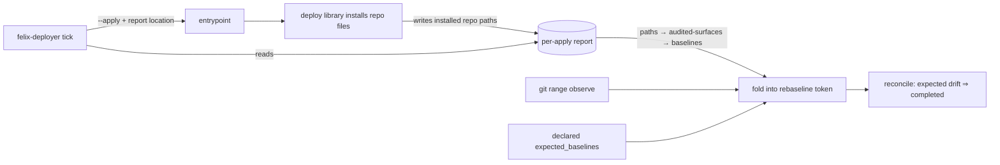

# Mission Specification: Deploys report what they installed so the rebaseline expects it

**Mission Branch**: `fix/deploy-runtime-installed-report`
**Created**: 2026-10-15
**Status**: Draft
**Input**: kentonium3/kg-automation#1072 (spec-ready body). Design approach decided by Kent: "Runtime report" (decision `DM-01M4ZP8Z1P0SN3JYYS56HPPYV0`). Intent Summary confirmed by Kent, with authority to drive the full mission (decision `DM-01M4ZP94VW9PN60528YHSRXH23`).

## Intent Summary

- **Primary actor**: felix-deployer, the unattended pull-based applier on office2, which ticks every 5 minutes.
- **Trigger**: a queued manifest's entrypoint runs `--apply`.
- **Desired outcome**: the deploy library records which repository files it actually installed on the host. After the apply, the deployer turns those files into the security-monitor baselines they affect, using the same audited-surface declarations it already uses for git changes, and expects that drift. A deploy that re-installs files committed earlier (deploy 0029's shape) then ends `completed`, with no action from the manifest's author.
- **Invariants**:
  1. A missing, malformed, or out-of-repository report never crashes a tick and never hides genuinely unexpected drift. It is logged and treated as "nothing reported".
  2. A deploy that installs nothing on an audited surface still ends `not_required` / `cleared_clean`.
  3. A manually declared `expected_baselines` behaves exactly as today.
- **Out of scope**: migrating historical entrypoints, shell installers, and changing the security audit itself.

## Background

The deployer decides which baselines a deploy will change from **the files changed in the commit range it pulled**. Drift, however, comes from **what was installed on the host**. The two coincide only when a deploy installs files changed in that same range. A reconcile deploy installs files committed earlier, so the deployer expects nothing and the security monitor raises a false `unexpected_drift` alert, unless the author remembered `expected_baselines`. Deploy 0029 did not.

**Scope correction (2026-10-15, post-plan review):** of the five historical `unexpected_drift` episodes in the deployer logs, only 0029's is this class. 0027 (`brew-packages.txt`) was unrelated host drift with no repo input; it was a correct alert, and this mission must not suppress it. Two runtime `openclaw-config` changes and 0030's shell entrypoint (Docker images, ports) need declared `expected_baselines`, which stays essential. The guidance was corrected in five places by #1065, but documentation alone has already failed twice. Since #1066, every new unit-installing entrypoint must use `scripts/deploy/lib/userunits.py`, so the library is the one place that always knows what was installed.

## User Scenarios & Testing *(mandatory)*

### User Story 1 - A reconcile deploy rebaselines cleanly (Priority: P1)

An operator queues a deploy that re-installs systemd units committed weeks earlier, through the deploy library, with no `expected_baselines`. felix-deployer applies it, learns which unit files were installed, expects the unit-content baseline to drift, and rebaselines. The deploy record ends `completed`, and no false security alert fires.

**Why this priority**: this is the defect. A false security alert after an intended change teaches the operator to ignore the security monitor.

**Independent Test**: replay 0029's shape through the real tick with a fake audit that reports `systemd-user-unit-contents.txt` drifted. The outcome is `completed`, where today it is `unexpected_drift`.

**Acceptance Scenarios**:

1. **Given** an entrypoint that installs an already-committed unit on the systemd-user-units surface through the library, and no `expected_baselines`, **When** the deployer applies it and the audit then reports that baseline drifted, **Then** the rebaseline outcome is `completed`.
2. **Given** the same deploy, **When** the tick runs, **Then** the tick log names the reported files and the baselines they mapped to.
3. **Given** an entrypoint run with `--dry-run`, **When** it executes, **Then** nothing is reported (a dry run installs nothing).

---

### User Story 2 - Nothing reported, nothing expected (Priority: P1)

A deploy installs no audited file, or reports nothing at all. The deployer's behavior is exactly today's: no spurious token and no spurious expectation.

**Why this priority**: an expectation that is too broad would hide genuinely unexpected drift, which is the security monitor's whole job.

**Independent Test**: an entrypoint that reports a file on no audited surface, and one that reports nothing, both produce the same token state as before this mission.

**Acceptance Scenarios**:

1. **Given** a report naming only files that match no audited surface, **When** the tick runs, **Then** no baseline is added to the expected set.
2. **Given** no report at all, **When** the tick runs, **Then** behavior is identical to today.

---

### User Story 3 - A bad report cannot hurt the tick (Priority: P1)

The report is missing, unreadable, malformed, or names paths outside the repository. The tick logs it, treats it as "nothing reported", and carries on. Real drift is still classified correctly.

**Independent Test**: each fault shape is injected. The tick completes, a warning event is logged, and reconcile's verdict matches what it would be with no report.

**Acceptance Scenarios**:

1. **Given** a report that is not valid, **When** the tick runs, **Then** a warning is logged and no baseline is added.
2. **Given** a report naming `/etc/passwd` or `../../x`, **When** the tick runs, **Then** those entries are rejected and logged, and none is mapped.

### Edge Cases

- **Failed `--apply` that installed some files**: files that were installed still drift, so whatever was reported is folded even when the apply failed. Declared `expected_baselines` keeps its existing success-only gate. The tick log records which case applied.
- **Several manifests in one tick**: each apply gets its own report location; the reported baselines are unioned.
- **A file reported as installed but unchanged (byte-identical)**: no drift occurs, so it is not reported.
- **Trust model**: entrypoints run as the same user as the deployer and are PR-reviewed; the report guards against bugs and mistakes, not a malicious entrypoint (which could already write anything that user can).
- **Out-of-band drift on a reported file**: a deployed copy that had drifted out of band and is then overwritten is absorbed into the rebaseline. That is intended, and it is logged.
- **Entrypoint not using the library**: nothing is reported, and behavior is as today. Declared `expected_baselines` remains the escape hatch.
- **The audited-surface registry is unreadable**: no mapping is possible. This is logged as a warning and treated as "nothing reported", as `observe` already does for git ranges.

## Requirements *(mandatory)*

### Functional Requirements

| ID | Title | User Story | Priority | Status | Delivery | No-op passable? |
|----|-------|------------|----------|--------|----------|-----------------|
| FR-001 | Library reports installed files | As felix-deployer, I want the deploy library to record, for each apply, the repository files it actually wrote to the host (changed ones only), so that I know what will drift. | High | Open | [build] | no: an install with a report location set must produce a report naming the changed files; with none set, nothing is written |
| FR-002 | Per-apply report location | As felix-deployer, I want to give each manifest's `--apply` (and only `--apply`) its own fresh report location, so that reports never leak between manifests or from dry runs. | High | Open | [build] | no: dry-run and verification commands receive no location; two manifests get distinct ones |
| FR-003 | Reported files become expected baselines | As felix-deployer, I want reported files mapped through the audited-surface declarations to their surfaces' baselines and folded into the rebaseline token, so that 0029's shape ends `completed`. | High | Open | [build] | no: the 0029 replay ends `completed` here and `unexpected_drift` without this requirement |
| FR-004 | Bad reports are harmless, wholesale | As the operator, I want a report that is missing, unreadable, not a regular file, oversized, malformed in any line, over the entry limit, or naming any source outside the repository or any destination outside the declared host location to be rejected **as a whole**, logged, and contribute nothing, never crashing the tick or widening expectations, so that the security monitor stays trustworthy. | High | Open | [build] | no: each fault shape, including mixed valid and invalid reports, yields a warning event and an unchanged expected set |
| FR-005 | Declared baselines unchanged | As an operator, I want `expected_baselines` to behave exactly as today and to be unioned with reported baselines, so that runtime-CLI deploys still work. | High | Open | [ratchet] | yes, paired with FR-003's fixture: the same manifest with a declared baseline and a report yields the union |
| FR-006 | Observable | As the operator, I want the tick log to show which files were reported per manifest and which baselines they produced or why they were ignored, so that a rebaseline outcome can be explained after the fact. | Medium | Open | [build] | no: the tick log contains a reported-files event naming files and baselines |
| FR-007 | Failed-apply reports still count | As felix-deployer, I want files reported by a failed `--apply` folded too, because they were installed and will drift. | Medium | Open | [build] | no: a failing apply that reported a unit file still folds its baseline |
| FR-009 | Proof of an audited installation | As the operator, I want a reported file to count only when its **destination** is inside the host location the matching surface declares (for systemd user units, `~/.config/systemd/user/`), so that copying a repo file to scratch, or reporting a file that was never installed where the audit looks, cannot widen expectations. | High | Open | [build] | no: a correct source with a scratch destination contributes nothing; the same source with the real destination contributes |
| FR-010 | Guidance and recurrence guard | As a maintainer, I want new deploy code that copies files to the host to go through a reporting installer (guard test), and the report writer to live in one shared module, so that the next installer cannot silently forget to report. | Medium | Open | [build] | no: the guard catches a new hand-rolled host copy |
| FR-008 | Guidance narrows | As a manifest author, I want the docs to say that library installs are automatic, and that `expected_baselines` remains required for every other drift (runtime CLI changes, shell entrypoints, non-repo effects), so that authors stop guessing without over-trusting the report. | Low | Open | [build] | no: a docs test asserts the runbook names the automatic path |

### Non-Functional Requirements

| ID | Title | Requirement | Category | Priority | Status |
|----|-------|-------------|----------|----------|--------|
| NFR-001 | No tick slowdown | Reading and mapping reports adds under 1 s per tick for up to 10 manifests with 100 reported files each. | Performance | Low | Open |
| NFR-002 | Never crash | 100% of injected report-fault shapes (absent, empty, non-JSON, wrong types, oversized over 1 MiB, out-of-repo, unreadable registry) leave the tick completing and reconcile's verdict unchanged from the no-report case. | Reliability | High | Open |
| NFR-003 | Non-vacuous tests | Every new behavior has a test that fails when the behavior is removed (spot-checked by mutation). | Maintainability | High | Open |

### Constraints

| ID | Title | Constraint | Category | Priority | Status |
|----|-------|------------|----------|----------|--------|
| C-001 | One matcher | Reported files are mapped with the same audited-surface matcher and registry `observe` uses. There is no second mapping table. | Technical | High | Open |
| C-002 | Expectation only grows from evidence | A baseline is added only if a reported, in-repository file matches a surface that declares it. Nothing is ever added "to be safe". | Security | High | Open |
| C-003 | Deploy discipline | Tier 3 (deployer and library code). It ships through main and the deployer's own pull. The deployer runs from its checkout, so the change takes effect on the next tick. No host or audit change. | Operational | High | Open |
| C-004 | Out of scope | Historical entrypoints, shell installers, and changes to `audit.sh` or the baseline set. | Scope | Medium | Open |

### Key Entities

- **Installed-file report**: a per-apply record of repository files the library wrote to the host, each as a repository-relative path.
- **Audited surface**: an entry in `audited-surfaces.json` mapping repo path patterns to the baselines they affect.
- **Rebaseline token**: the deployer's pending expectation (`expected_baselines`), into which git-observed, declared, and now reported baselines are folded.

## Assumptions

- Only the library's unit installer (`userunits`) reports in this mission. Other library installers can adopt the same report later.
- The deployer and the entrypoint run on the same host as the same user. The report location is a file the deployer creates and owns.
- A file that is installed but already byte-identical cannot drift, and is not reported.

## Success Criteria *(mandatory)*

### Measurable Outcomes

- **SC-001**: Replaying deploy 0029's shape ends `completed` instead of `unexpected_drift`, with no `expected_baselines` in the manifest. — [build] · no-op passable: no (today's behavior on the same fixture is the control)
- **SC-002**: Across all injected report-fault shapes, zero ticks crash and zero baselines are added. — [build] · no-op passable: no
- **SC-003**: A deploy that installs nothing audited produces the same token as before this mission, byte for byte. — [ratchet] · no-op passable: yes, so it is paired with SC-001 on the same harness
- **SC-004**: After deploy, the first real tick on office2 runs cleanly with the new code (no `tick_error`), and the deploy-pipeline rebaseline ends `cleared_clean`. — [build] · no-op passable: no
