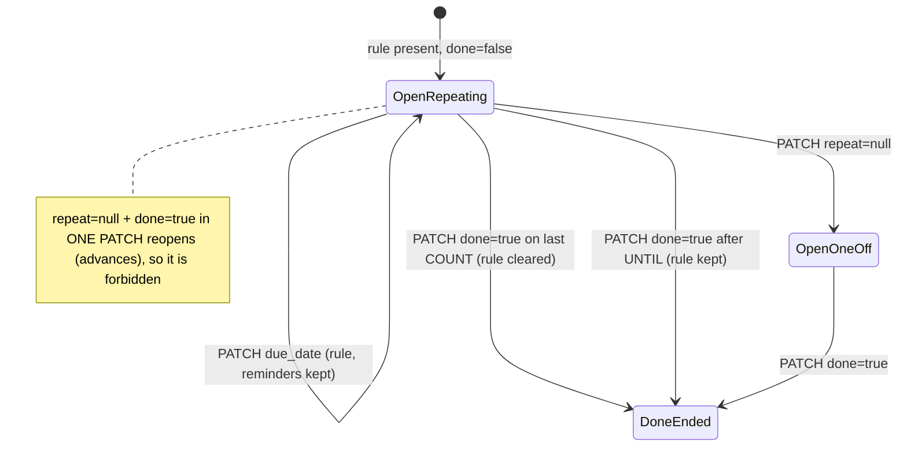

# Data Model: Felix RRULE recurrence adaptation

## Entities

### Rule (Vikunja `repeat`)

The server owns it. Felix only reads it, compares it, and passes it through. It is never synthesised except where a create or repair names it explicitly.

| Field | Type | Notes |
|---|---|---|
| `freq` | str | `secondly`…`yearly`. Responses are lowercase. |
| `interval` | int ≥1 | |
| `by_day` | list[str] | e.g. `["mo"]`, `["2tu"]` |
| `by_month_day`, `by_month`, `by_year_day`, `by_week_no`, `by_set_pos`, `by_hour`, `by_minute`, `by_second` | list[int] | |
| `count` | int | Occurrences *remaining*. It is decremented on each completion. |
| `until` | RFC3339 str | |
| `wkst` | str | |
| `read_only` | bool | Response-only. Dropped by the normaliser. |

Companion fields on the task:
- `repeats_from_current_date` (bool)
- `repeats_rrule` (RFC 5545 text, uppercase). It appears on v2 single-task GET and on create/update/PATCH responses, but not on lists.

**Normal form** (`vikunja_rule.normalise`):
- Drop `read_only`.
- Lowercase string parts and sort the `by_*` lists.
- Drop zero and empty values.
- Return `None` for no rule (`None` and `{}` are equivalent).

`same_rule(a, b)` compares normal forms.

### Task write operation (client seam)

| Operation | HTTP | Body | Success result |
|---|---|---|---|
| `patch_task(id, changes)` | `PATCH /api/v2/tasks/{id}` (merge-patch) | the changed keys only. A `None` value is refused with `ValueError`. | the 200 body, or `None` on 304 ("unchanged") |
| `end_series(id)` | PATCH `{"repeat": null}`, then PATCH `{"done": true}` | fixed | final task with `done=true` and no rule. Raises if it is not done. |
| `create_task_v2(project_id, fields, rrule=None, initial_due_time=None)` | `POST /api/v2/projects/{id}/tasks` | fields + `repeats_rrule` | the created task. The caller verifies the rule. |
| `occurrences(id, count=1..100)` | `GET /api/v2/tasks/{id}/occurrences` | — | `{occurrences: [RFC3339…], reason?}` |
| `preview_occurrences(rrule or repeat, due_date or initial_due_time, timezone, count)` | `POST /api/v2/tasks/occurrences/preview` | per contract | `{occurrences, reason?, due_date?, due_date_source?, timezone, evaluated_at}` |
| `get_task_v2(id)` | `GET /api/v2/tasks/{id}` | — | task including `repeats_rrule` |
| `update_task_fields(id, changes)` (fallback) | v1 GET, then full-echo POST (calls `self.post` directly, since `replace_task_fields` is removed) | full echo | **Guarded** (FR-002, post-plan review finding 10): refuses when the current task has a rule or reminders and `changes` would drop or alter them. Changing them needs `allow_rule_change=True`. No planned caller. |
| ~~`replace_task_fields`~~ | removed | | |

### Completion outcome

`completion_outcome(before, after, *, exhaustion_expected) → advanced | series_ended | unexpected` (R-010, as revised by post-plan review finding 2).

- `advanced`: the task was repeating before, and after the write it is `done=false` with `due_date` later than before. The rule after the write either equals the rule before, or differs only by COUNT being one lower.
- `series_ended`: after the write it is `done=true`, **and** exhaustion was established by an explicit reason (revised by re-review new-HIGH 1). That holds in two cases:
  - `count == 1` before the write, and the rule is absent after it. This is checked locally.
  - `until` is set, `repeats_from_current_date` is **false**, and `preview_occurrences(repeat=before.repeat, due_date=before.due_date, repeats_from_current_date=false, count=1)` returns `reason == "until_passed"` or `"count_exhausted"`.

  An empty list with any other reason, or no reason (for example `anchor_beyond_horizon` or `no_occurrence`), does **not** qualify. Neither does a rule with `repeats_from_current_date=true`, because preview cannot reproduce completion-time context for it.
- `unexpected`: everything else, including `done=true` when exhaustion was not established, which covers evaluation refusal and horizon limits. The caller logs it and raises an alert, and never reports it as advanced or ended.

`exhaustion_expected(before)` is computed **before** the write, and returns `yes`, `no` or `unknown`: COUNT is checked locally, and UNTIL is checked through preview under the conditions above. If preview cannot be called (a 401 or a timeout), or the from-current flag is set, the result is `unknown`. An outcome of `done=true` with anything but `yes` is `unexpected`: it is logged, raises an alert, and is never reported as advanced or ended.

### Habit schedule entry (YAML `habits:` block)

| Field | Before | After |
|---|---|---|
| `task_id`, `title`, `designated_weekdays` | same | same |
| `repeat_after_seconds` | int | **removed** |
| `rrule` | — | **new**, RFC 5545 text, e.g. `FREQ=DAILY;INTERVAL=1` or `FREQ=WEEKLY;BYDAY=MO` |

The #608 ratchet is re-expressed: a day-specific entry's rule must be weekly (or longer) and its `BYDAY` must equal `designated_weekdays`.

Drift check result: `{task_id, schedule_rrule, live_rrule, status: match | missing | differs | unreadable}`. It is read-only.

### Sync cache task entry

`TRACKED_TASK_FIELDS` gains `repeat` (compared in normal form) and `repeats_from_current_date`.

**Seed rule** (revised by post-plan review finding 9): a cached entry missing either key adopts the live value without raising a divergence, once per task. Seeding is **recorded, not silent**: each seed appends `{task_id, field, seeded_value, cycle_id}` to `seed-ledger.jsonl` in the sync state directory, and the cycle summary carries `baseline_seeded=N`.

A rule lost before the first observation is caught by the post-deploy inventory, not by the sync. The inventory compares against the pre-cutover snapshot, which does not depend on the seed. The rollout runs the inventory **after** the first sync cycle and cross-checks it against `seed-ledger.jsonl`. A task seeded with no rule whose baseline had a rule is classified as follows. This runs **after** the normal-end check (re-review new-HIGH 2):

- If the task is done and the baseline rule had COUNT or UNTIL, it is `ended` or `removed`. It could have ended normally, so it goes to Kent and is never auto-repaired.
- If the baseline rule had **no** COUNT or UNTIL, it cannot end on its own. It is `lost` if Felix attribution exists, and `removed` if not.

### Damage inventory entry

| Field | Notes |
|---|---|
| `task_id`, `project_id` | |
| `baseline_rule`, `baseline_source` | from the rule columns of the snapshot DB read-only copy (`snapshot:<dir>`), or `schedule` |
| `current_rule` | from v2 GET |
| `proposed_restore` | RFC 5545 text and `repeats_from_current_date` |
| `status` | One of the following (post-plan review finding 4): • `ok`: same rule. • `progressed`: same rule except COUNT is lower, which is expected. • `ended`: Done, and a COUNT-exhausted rule cleared or an UNTIL passed. • `lost`: the rule is absent now and was present in the baseline, **and** Felix-write attribution exists. That means a Felix write log entry for the task after 2026-10-30 (sweeper ledger, habits history, escalation JSONL, intake reply log, or a migrate/bulk run record), with the task's `updated` within 120 s of that entry. This is the only status proposed for auto-repair (re-review finding 4). • `removed`: the rule is absent with no Felix attribution. It may be an intentional UI removal, so it is listed for Kent and never auto-repaired. • `changed`: the rule differs. This may be an intentional edit, so it is listed for Kent and never auto-repaired. • `unresolved`: there is no restore source. |
| `current_fingerprint` | `{repeat, repeats_rrule, repeats_from_current_date, reminders, done, due_date, updated}` as read during the inventory. `--apply` refuses a task whose fresh read differs from it (drift). |

### Live-write record (repair)

| Field | Notes |
|---|---|
| `run_id` | ULID |
| `task_id` | |
| `snapshot_path` | `/data/services/openclaw/state/vikunja-repair/<run_id>/<task_id>.before.json`, the task exactly as read from v2 GET, written and fsynced **before** the write |
| `before` / `after` | `{repeat, repeats_rrule, repeats_from_current_date, reminders, done, due_date}` |
| `readback_ok` | bool (`same_rule(after_readback, intended)`) |
| `restore_command` | `python3 -m scripts.vikunja.rule_repair --restore <snapshot_path>` |
| `issue_comment_url` | the #1111 comment that recorded it |

## State transitions

## Invariants

Each operation has its own invariant (post-plan review finding 1).

1. No Felix write sends a key it does not intend to change.
   - No write sends `null`, except in two places: `end_series` clearing the rule, and `restore` clearing a rule or a due date that its snapshot lacked. `patch_task` refuses `None` unless the caller is one of these internal paths. It uses a private `_allow_null` set, which is not part of the public signature.
   - Clearing reminders sends `[]`, never `null`.
2. **Non-completion writes** (due date, title, project move, priority, etc.): after the write the rule equals the rule before (`same_rule`). The write leaves `repeats_from_current_date` unchanged, and leaves `reminders` unchanged as a set, with relative reminders allowed to recompute.
3. **Completion writes** (`done=true` on a repeating task): the outcome must be `advanced` (the rule is equal, or only COUNT is one lower) or an expected `series_ended`. Anything else is `unexpected` and raises an alert. Tests cover:
   - COUNT=2 → COUNT=1 (advanced);
   - COUNT=1 → Done with no rule (series ended);
   - UNTIL passed → Done with the rule kept;
   - Done with no expected exhaustion → unexpected.
4. **`end_series`**: final state `done=true` **and** no rule, both verified by readback, in every branch. See the end-series recovery contract below.
5. **Live repair**: an intent record and the snapshot file are durable before the write. Every attempted write gets an outcome record (`ok | mismatch | unknown`).
6. The sweeper never writes a daily habit, and never writes a habit whose next date it could not get from the rule.

## End-series recovery contract (post-plan review finding 5)

`end_series(id)` is resumable and idempotent. It works from a fresh read:

| Fresh state | Action |
|---|---|
| open, rule present | PATCH `{"repeat": null}`, read back, then continue with the next row |
| open, no rule | PATCH `{"done": true}`, then read back |
| done, no rule | no-op; return as already ended |
| done, rule present | PATCH `{"repeat": null}`, which does not reopen because `done` is unchanged; then read back. `done` being true is not taken as proof of a normal end (re-review new-MEDIUM). |

- **Error after step 1:** raise `SeriesEndIncomplete(task_id, state="rule_cleared_not_done")`. Callers record it as a partial outcome and raise an alert. Running it again resumes from the fresh read.
- **Timeout:** the state is uncertain, so read the task again before deciding. Never assume either way.
- **Rule reintroduced between steps** (the fresh read before step 2 shows a rule): stop with `SeriesEndIncomplete(state="rule_reappeared")`.

## Repair restore algorithm (post-plan review finding 3)

Restore works field by field from the snapshot, and is ordered so that no step triggers completion semantics:

1. **Rule.** Write the snapshot's `repeats_rrule` text, which is the canonical form.
   - If the current rule exists and differs, first PATCH `{"repeat": null}`, then PATCH `{"repeats_rrule": text, "repeats_from_current_date": b}`. Clearing first defeats the stale-COUNT echo rule (`task_repeat_update.go:96-110`) and stops structured parts from merging.
   - If the snapshot had no rule, PATCH `{"repeat": null, "repeats_from_current_date": <snapshot value>}` (re-review finding 3).
2. **Reminders.** PATCH the snapshot's list, sending `[]` when it was `null`.
3. **Due date.** PATCH the snapshot's `due_date` when it differs. If the snapshot had no due date, PATCH `{"due_date": null}`. This is a sanctioned null, allowed only on the restore path (re-review finding 3).
4. **Done.** Restore `done=false` with a PATCH when the snapshot was open and the task is now done. A restore to `done=true` while the task has a rule is **refused** and reported for manual handling, because it would advance the series.
5. **Readback.** Compare all restored fields with the snapshot and report each difference.

Tests cover a different rule, a decremented COUNT, `null` reminders, and a change in completion state.
