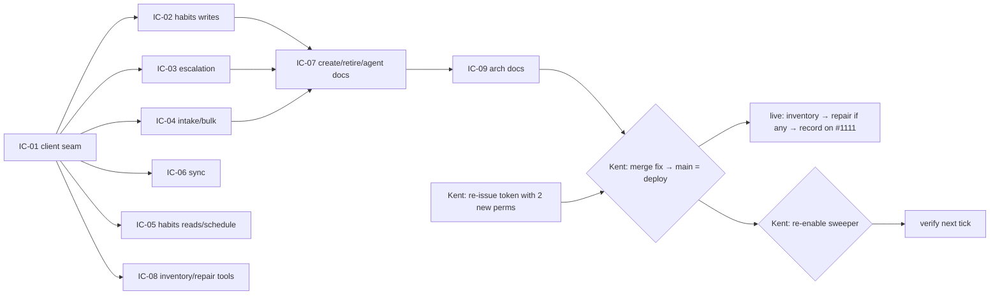

# Implementation Plan: Felix RRULE recurrence adaptation

**Branch**: `kitty/mission-felix-rrule-adaptation-01M7TKNX`, merging into `fix/felix-rrule-adaptation` (cut from `main` @ `cc4f2154`) | **Date**: 2026-11-19 | **Spec**: [spec.md](spec.md)
**Input**: Mission specification from `kitty-specs/felix-rrule-adaptation-01M7TKNX/spec.md`; tracking issue kentonium3/kg-automation#1111

## Summary

Move every Felix Vikunja task write onto a single client seam that uses Vikunja's v2 **partial update** (`PATCH /api/v2/tasks/{id}`, an RFC 7396 merge patch the server applies to its own GET). A field Felix does not name, including the rule, repeat-from-completion and reminders, can then no longer be cleared. The narrow v1 replace write is removed. The v1 full-echo write survives only as a documented fallback, and no planned caller uses it.

On top of that seam:

- Fix the habits, escalation, intake and bulk-tool callers.
- Make the habit schedule and weekly report read real rules, and make the sync see rule loss.
- Teach the agents the rule model.
- Retire `migrate_schedule`.
- Ship a read-only damage inventory and a reversible, recorded repair procedure for live data.

Native-rule features are adopted where they remove Felix-side date arithmetic: occurrences for the weekday-habit auto-skip, preview for the weekly report and for rule proposals, and v2 create with rule text. They depend on Kent re-issuing Felix's token with two new permissions (R-004).

## Technical Context

**Language/Version**: Python 3.12 on office2 (3.12.3; stdlib-only HTTP via `urllib`). Local dev is 3.13; code must stay 3.12-compatible.
**Primary Dependencies**: stdlib only for the client (`scripts/common/vikunja_client.py` already is); PyYAML for the habit schedule (existing); pytest for tests (existing). **No new dependencies** — the supply-chain controls (DIRECTIVE_051) have nothing to assess.
**Storage**: Vikunja (SQLite behind the API; Felix never touches the DB). Felix-side JSONL/JSON state under `/data/services/openclaw/state/{habits,escalation,sync}`. New: per-run snapshot files for live repairs under `/data/services/openclaw/state/vikunja-repair/<run-id>/`.
**Testing**: pytest, `make test` (`python3 -m pytest -q --ignore=docs/archive`). Vikunja is faked by monkeypatching `urllib.request.urlopen` (`tests/common/conftest.py:mock_vikunja_urlopen`). An autouse guard blocks live HTTP (`tests/conftest.py:22-37`). Plus `make` architecture validation (`tooling/scripts/validate_architecture_data.py --strict`). Local runs only, no CI trigger (C-003).
**Target Platform**: office2 (Ubuntu 24.04). Helpers run from `/home/claude/kg-automation`, and agent docs sync to `/data/services/openclaw/<agent>-agent/` and `~/.openclaw/skills/`.
**Project Type**: single repo, scripts + tests.
**Performance Goals**: no change. At most one extra GET per write (the readback/verify) and at most one occurrences call per day-specific habit per sweeper tick.
**Constraints**: v2 endpoints are fork-specific (v2.8.0-rrule.4 @ vikunja-harness `d7e202228`). Kent's ruling is that this is acceptable (Decision `01M7TKR2`). Never send an explicit JSON `null` except through the series-end operation. Treat 304 as "unchanged".
**Scale/Scope**: ~16 caller sites across `scripts/habits`, `scripts/escalation`, `scripts/intake`, `scripts/vikunja`, `scripts/sync`; ~30 test files with old-shape fixtures; 6 agent/skill docs; ~10 architecture docs/data files.

## Charter Check

*Charter: `.kittify/charter/charter.md`.*

| Gate | Status | Note |
|---|---|---|
| Branch strategy (solo, no PR, merge commits) | PASS | No PR; mission merges into `fix/felix-rrule-adaptation`. Kent merges that into `main`. |
| Testing: pytest coverage for non-trivial helpers | PASS | FR-020 / NFR-002 require red-then-green round-trip tests for every write path. |
| Testing: fixtures mirror real inputs | PASS | The new-shape fixture factory is seeded from a real v2 GET of task 14 (captured read-only 2026-11-19, R-003). |
| Testing: no dead code | PASS | `replace_task_fields` is removed, not left unused. Retired `migrate_schedule` and the `set_due_dates` reconcile mode are deleted, not orphaned. |
| Live verification (no staging) | PASS | Post-merge operator canary defined in [quickstart.md](quickstart.md). Results are recorded on #1111. |
| Change-risk tier | Tier 3 (scripts, agent prompts) for code. Live task writes are application data and run with snapshot-first plus readback (C-004). | No Tier 0/1/2 change. No compose, unit or schema edits. |
| Rebaseline obligation | PASS, not required | Agent prompts are not hashed (#621, `audited-surfaces.json:12-23`). No units, crons or manifests change. Merge trailer: `Rebaseline: not required — agent prompts not hashed (#621); no audited surface changed`. |
| Architecture docs standing requirement | PASS (planned) | IC-09 covers the signal-to-doc-map targets for data-flow, credential, service, agent-prompt, habits-flow and runbook classes. |
| Directive 6 (deterministic vs stochastic) | PASS | All Vikunja writes move into helpers. The agents keep only intent classification and call helpers (FR-006, FR-019). |

Re-checked after Phase 1 design: no new violations.

## Project Structure

### Documentation (this mission)

```
kitty-specs/felix-rrule-adaptation-01M7TKNX/
├── spec.md
├── plan.md              # this file
├── research.md          # Phase 0 findings (R-001…R-012)
├── data-model.md        # rule, write ops, inventory/repair records, state transitions
├── quickstart.md        # how to run tests, the dry runs, and the post-merge canary
├── contracts/
│   ├── vikunja-client-v2.md       # client seam contract
│   └── repair-and-inventory-cli.md
├── decisions/           # Decision Moments (Kent's rulings)
└── checklists/requirements.md
```

### Source Code (repository root)

```
scripts/common/vikunja_client.py        # IC-01: v2 root, patch_task, end_series, create_task_v2, occurrences, preview_occurrences
scripts/common/vikunja_rule.py          # IC-01 (new): rule normalise/compare/text helpers, finished-series detection
scripts/habits/record_completion.py     # IC-02
scripts/habits/sweeper.py               # IC-02 (O1)
scripts/habits/set_due_dates.py         # IC-02 (reconcile mode retired; bulk mode → patch_task)
scripts/habits/schedule_loader.py       # IC-05 (rrule per habit + drift check)
scripts/habits/migrations/phase3-schedule.yaml   # IC-05 (habits block only; operations frozen, C-005)
scripts/habits/query_active_habits_weekly.py     # IC-05 (O4)
scripts/habits/query_active_habits_v2.py, identify_workout_task.py   # IC-05
scripts/habits/migrate_schedule.py      # IC-07 (deleted)
scripts/escalation/record_completion.py, reconcile_completions.py    # IC-03
scripts/intake/apply_reply.py           # IC-04
scripts/vikunja/migrate_tasks.py, migrate_date_only_due_dates.py, create_task.py   # IC-04, IC-07
scripts/vikunja/rule_inventory.py       # IC-08 (new, read-only)
scripts/vikunja/rule_repair.py          # IC-08 (new; snapshot → write → readback → record)
scripts/sync/diff.py, classify.py, cycle.py, state.py   # IC-06
scripts/openclaw/agents/felix-admin-{escalation,habits,tasker}/*.md, skills/{escalation,task-intelligence,vikunja-api}/SKILL.md   # IC-07
tests/common/, tests/habits/, tests/escalation/, tests/intake/, tests/vikunja/, tests/sync/, tests/architectural/
docs/runbooks/vikunja-task-repair.md    # IC-08 (new runbook)
docs/design/architecture/**             # IC-09
```

**Structure Decision**: existing single-repo layout. Two new modules: `scripts/common/vikunja_rule.py`, a pure library, and the inventory/repair helpers under `scripts/vikunja/`. No package restructuring.

## Implementation Concern Map

> Concerns are not work packages. `/spec-kitty.tasks` maps them to WPs, starting from #1111's WP01–WP08 split.

### IC-01 — Client seam: partial update first

- **Purpose**: One write primitive that cannot strip: v2 merge-patch with null refusal and 304 handling, plus series end, v2 create, occurrences, preview, and a rule-comparison library. Remove the narrow v1 replace.
- **Relevant requirements**: FR-001, FR-002, FR-020 (factory), C-001, C-006
- **Affected surfaces**: `scripts/common/vikunja_client.py`, new `scripts/common/vikunja_rule.py`, `tests/common/test_vikunja_client.py`, `tests/common/conftest.py` (new-shape factory), `scripts/common/vikunja_config.py` (doc only; regex unchanged)
- **Sequencing/depends-on**: none. Everything else depends on it.
- **Risks**:
  - The v2 root derivation must not loosen the `/api/v1` config contract (R-002).
  - Merge-patch `null` semantics (R-001).
  - `replace_task_fields` has callers in IC-02, IC-04 and IC-07, which must move in the same mission or its removal breaks them. It is removed last, once the callers have moved; the tasks phase sequences this.
  - `end_series` must follow the resumable recovery contract (data-model.md; post-plan finding 5).
  - The fallback `update_task_fields` must call `post` directly and carry the FR-002 guard (finding 10).
  - `completion_outcome` needs the "exhaustion expected" input, computed before the write (finding 2).

### IC-02 — Habits writes

- **Purpose**: Completion and auto-skip keep the rule. The sweeper takes weekday habits' next date from occurrences, and skips and alerts when a habit has no rule. The `set_due_dates` reconcile mode is retired; its bulk mode moves to `patch_task`.
- **Relevant requirements**: FR-003, FR-004, FR-005, FR-014, FR-020
- **Affected surfaces**: `scripts/habits/{record_completion,sweeper,set_due_dates}.py`, their tests (`test_record_completion.py`, `test_sweeper_*.py`, `test_set_due_dates_*.py`), `tests/habits/conftest.py`
- **Sequencing/depends-on**: IC-01
- **Risks**: The sweeper must still write nothing for daily habits (current behaviour, R-006). A 401 from occurrences must surface as an alert, not a guessed date (R-004). A finished series on completion must report `series_ended`.

### IC-03 — Escalation

- **Purpose**: The agent never writes Vikunja. The helper's done/reschedule move to v2 `patch_task`, which fixes the v1 PATCH 405 (R-005). Reconcile labels "rule present and due date advanced" as a completion. A finished series is recognised.
- **Relevant requirements**: FR-006, FR-014, FR-015, FR-020
- **Affected surfaces**: `scripts/escalation/record_completion.py`, `scripts/escalation/reconcile_completions.py`, `scripts/openclaw/agents/felix-admin-escalation/{AGENTS,TOOLS}.md`, `scripts/openclaw/skills/escalation/SKILL.md`, `tests/escalation/*`
- **Sequencing/depends-on**: IC-01
- **Risks**:
  - Helpers and agent docs reach office2 by different paths: the checkout pull, and the 5-minute prompt/skill sync plus session-init prompt caching. A merge therefore does **not** switch them together (post-plan finding 7).
  - The dangerous interleaving is new helper plus old doc. The old doc's POST strips the rule, then the working helper closes the task. New doc plus old helper is safe, because the v1 PATCH 405s and writes nothing.
  - Mitigation: the rollout-window procedure in quickstart.md. `N done` replies are paused from the merge until the synced copies and a fresh escalation session are confirmed.

### IC-04 — Intake and bulk tools

- **Purpose**: Replace both writable-field allowlists with `patch_task` of the changed fields only, and assert the rule is unchanged after the write. Eliminate a recurring task through `end_series`. Fix `_is_recurring`.
- **Relevant requirements**: FR-007, FR-008, FR-009, FR-010, FR-020
- **Affected surfaces**: `scripts/intake/apply_reply.py` (allowlist L168-181, `_post_task_fields` L443-484, eliminate L588-591, `_is_recurring` L419-422), `scripts/vikunja/migrate_tasks.py` (allowlist L143-156, `_writable_payload` L778-785, POST L826), `scripts/vikunja/migrate_date_only_due_dates.py`, `tests/intake/test_apply_reply.py`, `tests/vikunja/test_migrate_tasks.py`
- **Sequencing/depends-on**: IC-01
- **Risks**: The allowlist exists twice, not once (R-007). A project move through PATCH (`project_id`) must be verified in a test against the fork's documented behaviour.

### IC-05 — Habits reads, schedule and weekly report

- **Purpose**: The schedule declares an `rrule` per habit, replacing `repeat_after_seconds`. A read-only load-time drift check compares it with the live rule. The weekly report classifies habits from the rule and counts scheduled days from it. The read-only reporters emit the rule.
- **Relevant requirements**: FR-012, FR-013, FR-017
- **Affected surfaces**: `scripts/habits/{schedule_loader,query_active_habits_weekly,query_active_habits_v2,identify_workout_task,weekly_report_driver}.py`, `scripts/habits/migrations/phase3-schedule.yaml` (habits block only), `scripts/sync/cleanup.py` (must keep `prune_schedule_yaml` working), `tests/habits/test_schedule_loader.py`, `test_query_active_habits_weekly.py` + `fixtures/weekly_report_responses.json`, `test_query_active_habits_v2*.py`, `test_identify_workout_task.py`, `tests/sync/test_cleanup.py`
- **Sequencing/depends-on**: IC-01
- **Risks**: Daily habits' scheduled days can be computed locally from a `FREQ=DAILY;INTERVAL=1` rule. Preview is needed only for other rules, so a 401 there affects only non-daily habits (R-004). The schedule check must never write (FR-013). The #608 ratchet (day-specific needs ≥1 week cadence) is re-expressed on the rule.

### IC-06 — Sync tracks the rule

- **Purpose**: Track `repeat` (normalised) and `repeats_from_current_date`, add them to the downstream-affecting set, and seed the new fields silently on the first cycle.
- **Relevant requirements**: FR-016, NFR-004
- **Affected surfaces**: `scripts/sync/{diff,classify,cycle}.py`, possibly `state.py`, `tests/common/conftest.py` (`_TRACKED_TASK_FIELDS` copy), `tests/sync/test_diff.py`, `test_classify.py`, `tests/common/test_sync_cache.py`
- **Sequencing/depends-on**: IC-01 (rule normaliser)
- **Risks**:
  - A naive add causes a one-time unsafe-divergence burst, hitting the G-3 cap (R-008).
  - The seed rule: a cached entry that lacks the key adopts the live value without a divergence, exactly once per task.
  - Seeds are recorded in `seed-ledger.jsonl`, not silent. A loss that happens before the first observation is caught by the post-deploy inventory's seed-ledger cross-check (post-plan finding 9).
  - No schema-version bump, because that forces an operator re-bootstrap.

### IC-07 — Create paths, retirement, agent guidance

- **Purpose**: `create_task --rrule` via v2 create with readback. Retire `migrate_schedule` and update every reference. Rewrite the agent and skill guidance to the rule model, with a preview-backed rule check that shows the next three dates.
- **Relevant requirements**: FR-011, FR-018, FR-019, NFR-001
- **Affected surfaces**: `scripts/vikunja/create_task.py` + tests; delete `scripts/habits/migrate_schedule.py` + `tests/habits/test_migrate_schedule.py`; edit `tests/architectural/test_habits_history_canonical_read.py:63` (mandatory), `tests/habits/conftest.py:191`, the docstrings in `vikunja_client.py`, `schedule_loader.py` and `sync/cleanup.py`, and the YAML header comments; `scripts/openclaw/skills/{task-intelligence,vikunja-api}/SKILL.md`, `scripts/openclaw/agents/felix-admin-{tasker,habits}/AGENTS.md`
- **Sequencing/depends-on**: IC-01. The agent-doc parts follow IC-02, IC-03 and IC-04 so they describe shipped helpers.
- **Risks**: Docs must not tell an agent to call a helper that does not exist yet. Remove the stale 2.4.0-era `/tasks/all` caveats while there (R-011).

### IC-08 — Live-data inventory and reversible repair

- **Purpose**: A read-only inventory of tasks whose rule differs from the cutover baseline or the 2026-11-19 audit state. A repair helper that snapshots, writes via `patch_task`, reads back, prints a restore command and emits a #1111 record. A new runbook.
- **Relevant requirements**: FR-021, FR-022, NFR-005, C-004
- **Affected surfaces**: new `scripts/vikunja/rule_inventory.py`, `scripts/vikunja/rule_repair.py`, tests, new `docs/runbooks/vikunja-task-repair.md`
- **Sequencing/depends-on**: IC-01. Runs live only after the deploy (C-004).
- **Risks**:
  - The inventory must separate expected progress (lower COUNT, a normal series end) and intentional edits (`changed`, which goes to Kent) from damage (`lost`). Only `lost` is auto-repaired (finding 4).
  - `--apply` refuses a task whose state has drifted from its inventory fingerprint (finding 4).
  - Each write follows the sequence snapshot, intent journal, write, readback, outcome journal (`ok | mismatch | unknown`), and `--resume` recovers an interrupted run (finding 6).
  - Restore uses the ordered algorithm in data-model.md: canonical text with clear-first, `[]` for null reminders, and controlled done transitions (finding 3).
  - The restore source for pre-cutover rules is not in the release baseline, which stores only a hash (R-009). The plan's source is the pre-cutover rollback DB snapshot, read through a read-only copy, plus the schedule for habits. The inventory is expected to be empty or near-empty (core worker audit). Posting to #1111 is Kent's own tracking record, so it is not copy-gated, but it must contain no `@mentions`.

### IC-09 — Architecture docs and data

- **Purpose**: Record the v2 data flows, the token-permission change and the removed component. Apply the signal-to-doc-map targets.
- **Relevant requirements**: FR-023
- **Affected surfaces**: `docs/design/architecture/data/{data-flows,service-inventory,credential-manifest,mutation-surfaces}.json` + their `.md` views; `docs/design/process-flows/habits.md`; `docs/INDEX.md`, `docs/DEVELOPER_PORTAL.md` (new runbook); `docs/runbooks/{openclaw-agent-setup,agent-prompt-sync-ops,deploy/office2-deploy-paths}.md` as the map requires
- **Sequencing/depends-on**: IC-01…IC-08 (documents what shipped)
- **Risks**: The validator is a blocking Docs-CI gate (`validate_architecture_data.py --strict`), so run it locally.

## Sequencing and gates



Kent's gates (C-002):

1. Re-issue Felix's token before the merge (R-004), and verify it with the R-004 probe **before** revoking the old token.
2. Merge `fix/felix-rrule-adaptation` → `main`, which is the deploy. `N done` replies stay paused from the merge until the rollout-window checks in quickstart.md pass. If Kent prefers, the `escalation-daily` cron is disabled for the window instead.
3. Re-enable `felix-habit-sweeper.timer`.

The live inventory and repair are pre-approved (Decision `01M7TN0V`). They run only after gate 2.

## Complexity Tracking

None. No charter violations.
