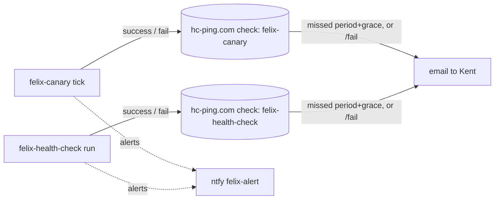

# Implementation Plan: Off-host dead-man pings for the on-host watchers

**Branch**: `feat/offhost-deadman-pings` | **Date**: 2026-10-15 | **Spec**: [spec.md](spec.md)
**Input**: Mission specification from `kitty-specs/offhost-deadman-pings-01M50990/spec.md` (kentonium3/kg-automation#1077, decided by RFC #1069)

## Summary

A small shared module, `scripts/common/deadman.py`, sends one bounded, best-effort ping to a healthchecks.io check: either `success` (the base URL) or `fail` (the base URL plus `/fail`). It reads the ping URL from the process environment, falling back to its own env file at `/home/claude/.config/felix/deadman/env`. Because it reads that file itself, **neither systemd unit changes**, so no audited surface is touched (`scripts/office2/*.service` is audited). It runs `curl` with the URL supplied on **stdin** (`curl -K -`), so the capability URL never appears in argv or the process list, with `--max-time 5` and a subprocess timeout of 8 s. It never raises.

- **felix-canary** pings after each non-dry-run pass from `main()`. The outcome is `success` when the pass status is `success` and every emitted alert was delivered, and `fail` otherwise. A runner-level exception also sends `fail`.
- **felix-health-check** pings after writing `last-run.json`. The outcome is `fail` when it tried to send an alert and delivery failed, or when writing the record failed; otherwise `success`.

## Technical Context

**Language/Version**: Python 3.12 (stdlib plus `curl`, the same transport as the alert bus)
**Primary Dependencies**: none new. Uses `subprocess` and `curl`, already used by `scripts/common/alert_bus/delivery.py`.
**Storage**: `/home/claude/.config/felix/deadman/env` (0600, claude-owned, provisioned by Kent, never committed). A template `scripts/common/deadman.env.sample` holds placeholders only.
**Testing**: pytest. Injected transport fakes for the module. The canary's `run_pass`/`main` seams (`emit_fn`, monkeypatched `run_pass`) and health-check's monkeypatched `send_alert`/`emit` carry a recording ping fake. A sentinel-URL secrecy test scans captured stdout, stderr, logs and written records.
**Target Platform**: office2. Both watchers run from the checkout, so the pull is the deploy.
**Project Type**: single repo, operations scripts
**Performance Goals**: at most 8 s added worst case per run, about 0 s when unconfigured (NFR-001)
**Constraints**: C-001 (alerting is email-only on healthchecks.io), C-002 (no secret in the repo), C-004 (watcher semantics unchanged), NFR-003 (no body), NFR-004 (https only)
**Scale/Scope**: 1 new module, 2 small hooks, 1 env template, architecture data and docs, and a runbook section

## Charter Check

- **Deterministic work (Directive 6)**: all deterministic; no agent prompt. Pass.
- **Engineering principle 14 (verified-false vs could-not-check)**: the ping's own failure is logged locally and changes no verdict. The remote side treats silence as failure, which is the point. Pass.
- **Engineering principle 15 ($HOME)**: uses the fixed path `/home/claude/...` (the same convention as `alert_bus.sh`), with an override variable for tests only. It never derives the path from `$HOME`. Pass.
- **Tier**: Tier 3 (Python logic plus a new user-scoped credential file). Pass.
- **Rebaseline (#557)**: no unit, deploy script, dependency manifest or Docker file changes. `audited-surfaces.json` matches none of `scripts/common/**`, `scripts/canary/**` or `scripts/office2/felix_health_check/**`. Result: `Rebaseline: not required`. Pass.
- **Architecture standing directive**: new credential (`credential-manifest.json`), new external flow (`data-flows.json`, plus the markdown view if it lists ntfy egress), `observability-and-alerting.md` §5a, and the canary and health-check inventory notes. Change classes from `signal-to-doc-map.json`: `credential-added-or-modified`, `data-flow-added-or-modified`, `runbook-modified`. Their doc targets are reviewed in the docs work package.

## Design decisions

1. **The module reads its own env file; no unit change.** An `EnvironmentFile=` line would touch an audited surface and force a rebaseline. A self-read mirrors `alert_bus.sh`. Process environment wins, so tests and the optional manual override still work.
2. **Each watcher uses its own variable:** `FELIX_DEADMAN_CANARY_URL` and `FELIX_DEADMAN_HEALTHCHECK_URL`. A misrouted ping is therefore impossible.
3. **URL validation.** The URL must be `https://`, have no whitespace or control characters, and be at most 512 characters. Otherwise nothing is sent and the log shows only the label "invalid". The host is not pinned, which allows a self-hosted healthchecks later.
4. **The secret never reaches argv.** The URL goes to `curl -K -` on stdin as a config `url = "..."` line, with the value escaped for curl's config syntax. Logs carry only `deadman <label> <outcome>: <ok|reason>`.
5. **Outcome semantics.**
   - `success` means the watcher ran *and* could have told Kent; it is liveness, not component health (FR-004).
   - `fail` means the watcher ran but an alert could not be delivered, or the runner itself errored.
   - Canary runner exceptions (rc 1) send `fail` before returning 1.
   - Dry-run and self-check send nothing.
6. **The canary counts undelivered alerts.** `run_pass` keeps `emit_fn`'s return value and counts `getattr(result, "ok", True) is False`. That expression treats a fake's `None` as delivered, so existing tests keep their meaning. The count goes into the returned summary as `alerts_undelivered` and is **excluded from the persisted tick signal**, like `component_lines`. That keeps felix-canary's key-ledger reconciliation (`tests/canary/test_tick_ledger_reconciliation.py`) unchanged.
7. **No retries.** The next tick is the retry.

## Implementation Concern Map

### IC-01 — `scripts/common/deadman.py`
- **Purpose**: one bounded, total, secret-safe ping.
- **Relevant requirements**: FR-005, FR-006, FR-007, NFR-001, NFR-003, NFR-004, C-002
- **Affected surfaces**: `scripts/common/deadman.py`, `scripts/common/deadman.env.sample`, `tests/common/test_deadman.py`
- **Sequencing/depends-on**: none
- **Risks**:
  - Curl-config escaping (quotes and backslashes).
  - The subprocess timeout must kill curl.
  - Env-file parsing must accept only `KEY=value` lines and ignore the rest.
  - `curl` missing from PATH must count as "unreachable", not a crash.

### IC-02 — Canary hook
- **Purpose**: count undelivered alerts, then ping from `main()`.
- **Relevant requirements**: FR-001, FR-003, FR-004, FR-006, C-004
- **Affected surfaces**: `scripts/canary/run.py`, `tests/canary/test_run_deadman.py`
- **Sequencing/depends-on**: IC-01
- **Risks**:
  - The tick-signal schema must stay unchanged; the reconciliation harness pins it.
  - Exit codes must stay unchanged.
  - Dry-run and self-check must stay silent.

### IC-03 — Health-check hook
- **Purpose**: ping after the record write, with outcome from `delivery`.
- **Relevant requirements**: FR-002, FR-003, FR-004, FR-006, C-004
- **Affected surfaces**: `scripts/office2/felix_health_check/run.py`, `scripts/office2/felix_health_check/tests/test_run_deadman.py`
- **Sequencing/depends-on**: IC-01
- **Risks**:
  - The record write can raise. Send a `fail` ping, then re-raise, preserving today's behaviour.
  - The return code stays 0 on the normal path.

### IC-04 — Architecture data, docs and runbook
- **Purpose**: record the credential and the flow; give the operator steps for provisioning (a `read -rs` one-liner through `ssh -t office2-claude`), rotation, pause and verification (including a deliberate `/fail` test).
- **Relevant requirements**: FR-008, FR-009
- **Affected surfaces**:
  - `docs/design/architecture/data/credential-manifest.json`
  - `docs/design/architecture/data/data-flows.json` and `data-flows.md` / `.view.md` if they enumerate egress
  - `docs/design/architecture/observability-and-alerting.md`
  - `docs/design/architecture/data/service-inventory.json` (canary and health-check notes plus `updated_by`)
  - `docs/runbooks/canary-registry-ops.md` (new section)
  - a docs test
- **Sequencing/depends-on**: IC-01 (variable names)
- **Risks**:
  - The validator's date-sanity rule (`last_updated` must be bumped).
  - Never put an example real URL in the docs; use `https://hc-ping.com/<uuid>` placeholders only.

## Deploy and live verification

1. Merge to `main`. felix-deployer's pull is the deploy (no manifest, no rebaseline).
2. With no env file present, both watchers keep running unchanged. Check the first canary tick on the new code: `status: success`, `errors: []`, and a journal line `deadman canary success: unconfigured`.
3. **Kent provisions the URLs**, from his own terminal (the established `ssh office2-claude` practice for claude-owned secrets):
   `ssh -t office2-claude 'umask 077; mkdir -p ~/.config/felix/deadman; read -rsp "canary ping URL: " C; echo; read -rsp "health-check ping URL: " H; echo; printf "FELIX_DEADMAN_CANARY_URL=%s\nFELIX_DEADMAN_HEALTHCHECK_URL=%s\n" "$C" "$H" > ~/.config/felix/deadman/env'`
4. Verify:
   - The next canary tick's journal shows `deadman canary success: ok`, and the healthchecks.io dashboard shows the ping.
   - Run felix-health-check once: start the service. It emits its usual alert, currently expected because of the integrity backlog. The check receives its ping.
   - **Fail test (SC-002)**, from Kent's terminal: `ssh office2-claude 'cd ~/kg-automation && python3 -m scripts.common.deadman --label canary --outcome fail'`. The module reads its own env file. Kent should get the email. The module offers that small CLI for operator testing; it prints no URL. The next real tick then returns the check to "up".

## Complexity Tracking

None.
