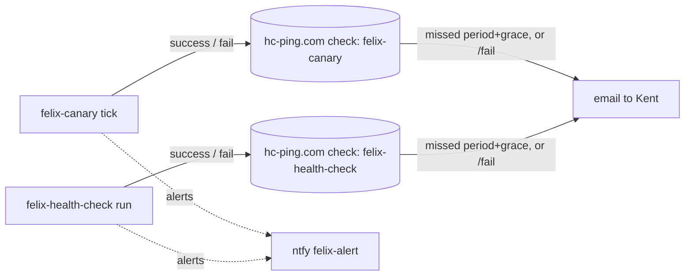

# Implementation Plan: Off-host dead-man pings for the on-host watchers

**Branch**: `feat/offhost-deadman-pings` | **Date**: 2026-10-15 | **Spec**: [spec.md](spec.md)
**Input**: Mission specification from `kitty-specs/offhost-deadman-pings-01M50990/spec.md` (kentonium3/kg-automation#1077, decided by RFC #1069)

## Summary

A small shared module, `scripts/common/deadman.py`, sends one bounded, best-effort ping to a healthchecks.io check: either `success` (the base URL) or `fail` (the base URL plus `/fail`). It reads the ping URL from the process environment, falling back to its own env file at `/home/claude/.config/felix/deadman/env`. Because it reads that file itself, **neither systemd unit changes**, so no audited surface is touched (`scripts/office2/*.service` is audited). It runs `curl` with the URL supplied on **stdin** (`curl -K -`), so the capability URL never appears in argv or the process list, with `--max-time 5` and a subprocess timeout of 8 s. It never raises.

- **felix-canary** pings after each non-dry-run pass from `main()`. The outcome is `success` when the pass status is `success` and every emitted alert was delivered, and `fail` otherwise. A runner-level exception also sends `fail`.
- **felix-health-check** pings after writing `last-run.json`. The outcome is `fail` when it tried to send an alert and delivery failed, or when writing the record failed; otherwise `success`.

## Technical Context

**Language/Version**: Python 3.12 (stdlib plus `curl`, the same transport as the alert bus)
**Primary Dependencies**: none new. Uses `subprocess` and `curl`, already used by `scripts/common/alert_bus/delivery.py`.
**Storage**: `/home/claude/.config/felix/deadman/env` (0600, claude-owned, provisioned by Kent, never committed). A template `scripts/common/deadman.env.sample` holds placeholders only.
**Testing**: pytest. Injected transport fakes for the module. The canary's `run_pass`/`main` seams (`emit_fn`, monkeypatched `run_pass`) and health-check's monkeypatched `send_alert`/`emit` carry a recording ping fake. A sentinel-URL secrecy test scans captured stdout, stderr, logs and written records.
**Target Platform**: office2. Both watchers run from the checkout, so the pull is the deploy.
**Project Type**: single repo, operations scripts
**Performance Goals**: at most 18 s added worst case per run (2 attempts), about 0 s when unconfigured (NFR-001, revised)
**Constraints**: C-001 (alerting is email-only on healthchecks.io), C-002 (no secret in the repo), C-004 (watcher semantics unchanged), NFR-003 (no body), NFR-004 (https only)
**Scale/Scope**: 1 new module, 2 small hooks, 1 env template, architecture data and docs, and a runbook section

## Charter Check

- **Deterministic work (Directive 6)**: all deterministic; no agent prompt. Pass.
- **Engineering principle 14 (verified-false vs could-not-check)**: the ping's own failure is logged locally and changes no verdict. The remote side treats silence as failure, which is the point. Pass.
- **Engineering principle 15 ($HOME)**: uses the fixed path `/home/claude/...` (the same convention as `alert_bus.sh`), with an override variable for tests only. It never derives the path from `$HOME`. Pass.
- **Tier**: Tier 3 (Python logic plus a new user-scoped credential file). Pass.
- **Rebaseline (#557)**: no unit, deploy script, dependency manifest or Docker file changes. `audited-surfaces.json` matches none of `scripts/common/**`, `scripts/canary/**` or `scripts/office2/felix_health_check/**`. Result: `Rebaseline: not required`. Pass.
- **Architecture standing directive**: new credential (`credential-manifest.json`), new external flow (`data-flows.json`, plus the markdown view if it lists ntfy egress), `observability-and-alerting.md` §5a, and the canary and health-check inventory notes. Change classes from `signal-to-doc-map.json`: `credential-added-or-modified`, `data-flow-added-or-modified`, `runbook-modified`. Their doc targets are reviewed in the docs work package.

## Design decisions

1. **The module reads its own env file; no unit change.** An `EnvironmentFile=` line would touch an audited surface and force a rebaseline. A self-read mirrors `alert_bus.sh`. Process environment wins, so tests and the optional manual override still work.
2. **Each watcher uses its own variable:** `FELIX_DEADMAN_CANARY_URL` and `FELIX_DEADMAN_HEALTHCHECK_URL`. A misrouted ping is therefore impossible.
3. **URL validation.** The URL must be `https://`, have no whitespace or control characters, and be at most 512 characters. Otherwise nothing is sent and the log shows only the label "invalid". The host is not pinned, which allows a self-hosted healthchecks later.
4. **The secret never reaches argv.** The URL goes to `curl -K -` on stdin as a config `url = "..."` line, with the value escaped for curl's config syntax. Logs carry only `deadman <label> <outcome>: <ok|reason>`.
5. **Outcome semantics.**
   - `success` means the watcher ran *and* could have told Kent; it is liveness, not component health (FR-004).
   - `fail` means the watcher ran but an alert could not be delivered, or the runner itself errored.
   - Canary runner exceptions (rc 1) send `fail` before returning 1.
   - Dry-run and self-check send nothing.
6. **The canary counts undelivered alerts.** `run_pass` keeps `emit_fn`'s return value and counts `getattr(result, "ok", True) is False`. That expression treats a fake's `None` as delivered, so existing tests keep their meaning. The count goes into the returned summary as `alerts_undelivered` and is **excluded from the persisted tick signal**, like `component_lines`. That keeps felix-canary's key-ledger reconciliation (`tests/canary/test_tick_ledger_reconciliation.py`) unchanged.
7. **No retries.** The next tick is the retry.

## Post-plan review dispositions (Codex REJECT, 2026-10-15). These supersede anything above that conflicts.

1. **HIGH: a missing topic reported success.** Channel health is now its own predicate in the module: `deadman.channel_broken(env)`. It is true when `FELIX_ALERT_NTFY_TOPIC` is absent or blank in the watcher's environment (checked without sending), or when the most recent record in the alert-bus ledger (`/data/services/alert-bus/ledger/<today>.jsonl`, falling back to yesterday) has `delivery.ok == false`. Both watchers send `fail` while it is true. Any failure to read the ledger counts as "unknown", which leaves the outcome unchanged; the topic check still applies.
2. **MED: dedup hid a broken channel.** This is solved by item 1. Channel debt lives in the shared ledger, which every emitter writes, so it is not cleared by component dedup. It clears only on a later successful delivery from any emitter (`alert_bus.sh self-test` is the operator's way to clear it on demand). The canary's own per-tick `alerts_undelivered` count stays an additional trigger.
3. **MED: watcher execution faults.** This is now FR-010. For the health check, `fail` when `script_status` is `SCRIPT_MISSING`, or the script note shows a timeout, launch or decode failure (`run.py:235-253`), or coverage "could not start", or the record write raised. For the canary, `fail` when the pass status is `error` or the pass raised. Exit codes are unchanged.
4. **MED: ambient curl config.** Argv becomes `curl -q --silent --show-error --fail --globoff --proto =https --proto-redir =https --max-redirs 0 --max-time 5 --retry 0 --output /dev/null -K -`. `-q` comes first so `~/.curlrc` is ignored. curl's stderr is captured and discarded; only the exit code is mapped. A test sets `CURL_HOME` and `HOME` to a directory with a hostile `.curlrc` and proves it is ignored.
5. **MED: environment-borne secrets.** URLs are read **only** from the env file into a private mapping; process-environment overrides are dropped. Nothing touches `os.environ`. curl gets an explicit minimal environment (`PATH`, `LANG=C`, no `HOME`, no proxy variables). A test asserts the child environment carries no URL.
6. **MED: URL canonicalisation.** Parse with `urllib.parse.urlsplit`. Require scheme `https` and a host. Reject any query, fragment, userinfo, whitespace, control characters, `"` or `\`. Reject a final path segment of `fail`, `start`, `log` or all digits. Strip one trailing `/`. The fail URL is `urlunsplit` with `path + "/fail"`.
7. **MED: scheduling.** office2 is `Etc/UTC`, so there is no daylight-saving issue. Kent switches the health-check check to Cron `0 11,23 * * *` UTC with 1 h grace. Each ping makes at most **2 attempts**, the second after 2 s; worst case is 2 × 8 s + 2 s = 18 s, which updates NFR-001. A double loss still produces one false email, accepted in the spec. The spec's "within grace" wording is corrected to "about an hour" for the canary (period plus grace).

## Post-plan re-review dispositions (Codex REJECT round 2, 2026-10-15). These supersede item 1 and item 2 above.

The shared alert-bus-ledger "channel debt" is **dropped**: it mixed emitters, expired at the second midnight, and read errors manufactured recovery. In its place, **each watcher owns its own delivery debt**:

- **State file.** Each watcher has a small state file in its own state directory: canary `/data/services/felix-canary/state/deadman.json`, health check `/data/services/openclaw/felix-health-check/deadman.json`. The content is `{"undelivered_since_utc": <iso>|null}`. It is written atomically (temp file + `os.replace`) and read only by its owner.
- **Setting debt.** Debt is set when any of the watcher's own alert deliveries in this run fails (canary: `alerts_undelivered > 0`; health check: alerting status with `delivery.sent` false).
- **Clearing debt.** Debt is cleared **only by a delivered alert from the same watcher**. While in debt, each run sends exactly one INFO verification alert (title "felix-alert channel verification", source `<watcher>/deadman`) through the normal `emit`. On delivery, the debt clears and the run pings `success`. That message is also Kent's "alert channel recovered" notice. If it is not delivered, the debt stays and the run pings `fail`. There are no time partitions, so nothing expires.
- **Fail-closed reads.** If the state file is missing it is treated as no debt, which is the first-run case. If it is unreadable or corrupt it is treated as **debt**, so the run attempts a verification alert and rewrites the file.
- **Cost of a broken channel.** One `fail` ping per run, but healthchecks.io emails only on the up-to-down transition, so Kent gets one email. Each run's verification attempt fails silently because ntfy is down.
- **Topic misconfiguration** (`FELIX_ALERT_NTFY_TOPIC` absent or blank in the watcher's own environment) is still checked each run without sending, and forces `fail`. Because it is the watcher's own environment, another emitter's misconfiguration cannot affect it.

The canary's verification alert goes through its injected `emit_fn`, and the health check's through its `send_alert`/`emit` seam, so both are testable with existing fakes. Neither the persisted tick-signal schema nor `last-run.json` changes.

## Post-plan re-review dispositions (Codex REJECT round 3, 2026-10-15). These supersede the round-2 section above. The design is now **stateless**.

Per-watcher debt files are **dropped**. Any persisted debt has write-failure, interruption and backup-restore skew modes: a clear-write failure means repeated verification alerts, and debt that fails to persist next to dedup state yields a false success. Instead, each run judges the alert channel **directly and freshly**, with no state:

`channel_ok` holds only when all three checks pass:
1. `FELIX_ALERT_NTFY_TOPIC` is present and non-blank in the watcher's own environment. This is checked without sending.
2. A **read-only health probe** of the ntfy server answers healthy: `GET <FELIX_ALERT_NTFY_BASE_URL or https://ntfy.sh>/v1/health` must return JSON `{"healthy": true}`. It runs through the same hardened curl transport (`-q`, `--proto =https`, no redirects, `--max-time 5`, 2 attempts). It publishes nothing and carries no secret.
3. Every alert **this run** tried to deliver was delivered:
   - canary: `alerts_undelivered == 0`, a summary-only count that is never persisted;
   - health check: not (an alerting status with `delivery.sent` false).

The ping is `success` only when the watcher ran without an execution fault **and** `channel_ok`. Otherwise it is `fail`.

- **No false recovery from dedup.** A tick whose page is dedup-suppressed still re-proves the channel via checks 1 and 2, so it cannot report "up" on a dead ntfy server or a missing topic.
- **What checks 1 and 2 cannot see:** a revoked or mistyped topic on a healthy server. That case surfaces through check 3 on the next real alert. This residual is accepted and recorded in the runbook.
- **Probe errors are `fail`,** which is fail-closed. A transient blip gives at most one down/up email pair, since healthchecks.io emails only on state change; 2 attempts make that rare.
- **Cost and volume.** About one extra small HTTPS GET per run, bounded like the ping; worst case per run is about 2 × 18 s. The probe is the same request for every run and needs no state. A long ntfy outage means `fail` every run but only one email, because the check simply stays down.

NFR-001 is revised to a 40 s worst case per run. The module exposes `deadman.channel_ok(env, delivered_ok) -> (bool, reason)` and `deadman.ping(...)`.

## Post-plan round 4 (Codex APPROVE-WITH-CHANGES, 2026-10-15)

**The probe's transport matches delivery's.** The ntfy `/v1/health` probe runs curl exactly as `alert_bus/delivery.py` does:
- it inherits the process environment, including proxy variables;
- it uses no `-q`, so curl's default config applies as it does for delivery.

That stops a broken proxy or curl config from passing the probe while real delivery fails. The probe carries no secret, so inheriting is safe. **Only the dead-man ping** keeps the hardened, minimal-environment, `-q` transport, because it carries the capability URL. A test asserts that the probe and delivery build the same environment and curl config context.

## Implementation Concern Map

### IC-01 — `scripts/common/deadman.py`
- **Purpose**: one bounded, total, secret-safe ping.
- **Relevant requirements**: FR-005, FR-006, FR-007, NFR-001, NFR-003, NFR-004, C-002
- **Affected surfaces**: `scripts/common/deadman.py`, `scripts/common/deadman.env.sample`, `tests/common/test_deadman.py`
- **Sequencing/depends-on**: none
- **Risks**:
  - Curl-config escaping (quotes and backslashes).
  - The subprocess timeout must kill curl.
  - Env-file parsing must accept only `KEY=value` lines and ignore the rest.
  - `curl` missing from PATH must count as "unreachable", not a crash.

### IC-02 — Canary hook
- **Purpose**: count undelivered alerts, then ping from `main()`.
- **Relevant requirements**: FR-001, FR-003, FR-004, FR-006, C-004
- **Affected surfaces**: `scripts/canary/run.py`, `tests/canary/test_run_deadman.py`
- **Sequencing/depends-on**: IC-01
- **Risks**:
  - The tick-signal schema must stay unchanged; the reconciliation harness pins it.
  - Exit codes must stay unchanged.
  - Dry-run and self-check must stay silent.

### IC-03 — Health-check hook
- **Purpose**: ping after the record write, with outcome from `delivery`.
- **Relevant requirements**: FR-002, FR-003, FR-004, FR-006, C-004
- **Affected surfaces**: `scripts/office2/felix_health_check/run.py`, `scripts/office2/felix_health_check/tests/test_run_deadman.py`
- **Sequencing/depends-on**: IC-01
- **Risks**:
  - The record write can raise. Send a `fail` ping, then re-raise, preserving today's behaviour.
  - The return code stays 0 on the normal path.

### IC-04 — Architecture data, docs and runbook
- **Purpose**: record the credential and the flow; give the operator steps for provisioning (a `read -rs` one-liner through `ssh -t office2-claude`), rotation, pause and verification (including a deliberate `/fail` test).
- **Relevant requirements**: FR-008, FR-009
- **Affected surfaces**:
  - `docs/design/architecture/data/credential-manifest.json`
  - `docs/design/architecture/data/data-flows.json` and `data-flows.md` / `.view.md` if they enumerate egress
  - `docs/design/architecture/observability-and-alerting.md`
  - `docs/design/architecture/data/service-inventory.json` (canary and health-check notes plus `updated_by`)
  - `docs/runbooks/canary-registry-ops.md` (new section)
  - a docs test
- **Sequencing/depends-on**: IC-01 (variable names)
- **Risks**:
  - The validator's date-sanity rule (`last_updated` must be bumped).
  - Never put an example real URL in the docs; use `https://hc-ping.com/<uuid>` placeholders only.

## Deploy and live verification

1. Merge to `main`. felix-deployer's pull is the deploy (no manifest, no rebaseline).
2. With no env file present, both watchers keep running unchanged. Check the first canary tick on the new code: `status: success`, `errors: []`, and a journal line `deadman canary success: unconfigured`.
3. **Kent provisions the URLs**, from his own terminal (the established `ssh office2-claude` practice for claude-owned secrets):
   `ssh -t office2-claude 'umask 077; mkdir -p ~/.config/felix/deadman; read -rsp "canary ping URL: " C; echo; read -rsp "health-check ping URL: " H; echo; printf "FELIX_DEADMAN_CANARY_URL=%s\nFELIX_DEADMAN_HEALTHCHECK_URL=%s\n" "$C" "$H" > ~/.config/felix/deadman/env'`
4. Verify:
   - The next canary tick's journal shows `deadman canary success: ok`, and the healthchecks.io dashboard shows the ping.
   - Run felix-health-check once: start the service. It emits its usual alert, currently expected because of the integrity backlog. The check receives its ping.
   - **Fail test (SC-002)**, from Kent's terminal: `ssh office2-claude 'cd ~/kg-automation && python3 -m scripts.common.deadman --label canary --outcome fail'`. The module reads its own env file. Kent should get the email. The module offers that small CLI for operator testing; it prints no URL. The next real tick then returns the check to "up".

## Complexity Tracking

None.
