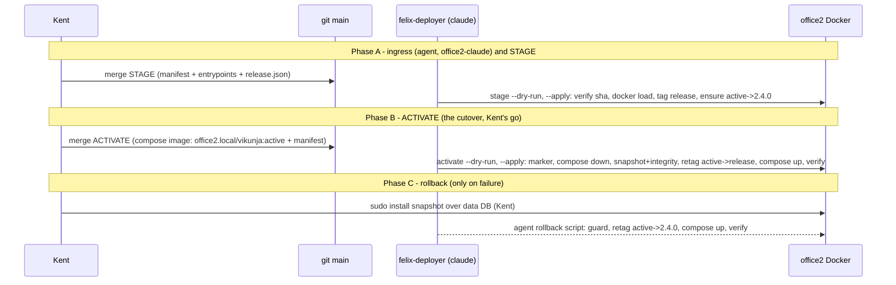

# Implementation Plan: Vikunja image-archive staging and activation deploy route

**Branch**: `feat/vikunja-image-deploy` (planning, base and merge target) | **Date**: 2026-10-30 | **Spec**: [spec.md](spec.md)
**Input**: Mission specification from `kitty-specs/vikunja-image-deploy-01M65D3V/spec.md`; tracking issue #1087.

## Summary

Two felix-deployer entrypoints and their manifests, a pinned release record, an operator ingress helper and an operator rollback script move Office2's Vikunja from `vikunja/vikunja:2.4.0` to the RRULE release image without a registry.

The Compose file stops naming a concrete image and instead names a **local indirection tag**, `office2.local/vikunja:active` (planning decision DM 01M65DEYQGJ955RRYWFD7WMBZ9, Kent, 2026-10-30). Only the ACTIVATE entrypoint moves that tag to the release, and only after a verified write-boundary snapshot. Consequences:

- Merging the Compose change is inert. A host reboot at any point starts whatever image the tag points at, which is 2.4.0 until the snapshot exists.
- Rollback is a retag plus the DB restore.
- The release image is staged by an inert STAGE step well before the cutover.

The ACTIVATE entrypoint stops and starts the service with the unit's own Compose commands as `claude` (specify decision DM 01M65D4SA1BBJA34C6PK32DQ7P, Kent, 2026-10-30). Kent's only privileged step is the DB restore during a rollback.



## Technical Context

**Language/Version**: Python 3.12 (office2 system Python; CI runs 3.12/3.13) for both entrypoints and their shared module. Bash for the two operator helpers.
**Primary Dependencies**: standard library only (`hashlib`, `json`, `subprocess`, `sqlite3`, `urllib.request`). Docker CLI 29.6 and Compose v5.3 on office2. The existing `scripts/deploy/lib/` (`installed_report`, `verify`). No new package, so the supply-chain review is not triggered.
**Storage**:
- `services/vikunja/release.json` is the pinned release record.
- Office2 paths, all `claude`-owned and mode 0700, under `/data/services/vikunja/`:
  - `release-artifacts/<archive-sha12>/` holds the ingress archives.
  - `snapshots/<UTC-stamp>/` holds the write-boundary DB snapshots.
  - `activation/<release-id>.json` is the one-shot marker.
**Testing**: pytest under `tests/deploy/`, loading the entrypoints with `importlib` and injecting fakes for the runner, clock, filesystem roots and HTTP opener, as in `tests/deploy/test_deploy_health_check_coverage.py`. The guard in `tests/deploy/conftest.py` blocks writes under `/data`. Each refusal has a same-fixture positive control. Exec-bit (100755) assertions for the entrypoints.
**Target Platform**: office2 (Ubuntu 24.04), run by felix-deployer as `claude` from `/home/claude/kg-automation`. The operator helpers run from office4 through `ssh office2-claude`.
**Project Type**: single repository; deploy scripts plus tests.
**Performance Goals**: cutover outage ≤ 5 minutes (NFR-001); readiness polling of `/api/v1/info` for at most 180 s.
**Constraints**:
- Tier 2, under the pipeline's own backup gate.
- Only the `--dry-run` and `--apply` arguments; no other inputs. Everything comes from `release.json`.
- No sudo inside entrypoints.
- No registry pull: the local names use the `office2.local/` prefix, so a missing tag fails a lookup rather than pulling.
- No production rows in any output (C-007).
**Scale/Scope**: one service on one host. Archives of 54 MB (release) and 116 MB (rollback). A 1 MB DB plus a 4 MB WAL.

## Charter Check

*GATE: Must pass before Phase 0 research. Re-check after Phase 1 design.*

| Charter rule | Status |
|---|---|
| Every office2 deploy flows through the manifest discipline (`deploys/queued/`, `scripts/deploy/lib`) | PASS. STAGE and ACTIVATE are manifests. The ingress copy and the emergency rollback are operator helpers, justified in research R-4 and R-7. |
| Strict order of operations: pre-flight, copy, verify, config, post-flight; halt on error | PASS. Both entrypoints are linear and halt on the first failed step. |
| Tier 2 needs Restic ≤ 24 h | PASS. Enforced by `apply.py` for tier-2 manifests; not bypassed. |
| Non-trivial Python ships with pytest; fixtures mirror real inputs | PASS. The fixtures come from the real archive's `manifest.json`, the config blob, a real `docker image inspect` shape and a Vikunja migration log line. |
| No dead code | PASS. Both entrypoints are referenced by manifests; the shared module is used by both. |
| Integration verification required, feasibility-scaled | PASS. Pre-merge: a read-only `--dry-run` of both entrypoints on office2 through `office2-claude`. Post-merge: the STAGE apply record, then the ACTIVATE apply record and the go-packet acceptance checks, as the recorded canary. |
| Rebaseline obligation | Applies. Both manifests set `audited_surface: true` and `expected_baselines: [docker-images.txt]`. The Compose change is in the pulled range for ACTIVATE. |
| Architecture docs updated with deploys | PASS. FR-016 is a work item. |
| Branching | PASS. All work lands on `feat/vikunja-image-deploy`. Merging it to `main` is Kent's, in two steps (STAGE, then ACTIVATE). |

## Project Structure

### Documentation (this mission)

```
kitty-specs/vikunja-image-deploy-01M65D3V/
├── plan.md
├── research.md
├── data-model.md
├── quickstart.md          # the go packet skeleton (operator steps)
└── contracts/
    └── entrypoints.md     # CLI contract of the two entrypoints and two helpers
```

### Source Code (repository root)

```
services/vikunja/
├── docker-compose.yml               # ACTIVATE commit: image: office2.local/vikunja:active (only line changed)
└── release.json                     # pinned release record (new)
scripts/deploy/
├── vikunja_release.py               # shared, pure-ish module: release record, docker/sha/sqlite/http primitives (new)
├── deploy-vikunja-release-stage.py     # STAGE entrypoint (new, 100755)
└── deploy-vikunja-release-activate.py  # ACTIVATE entrypoint (new, 100755)
scripts/vikunja/
├── stage-release-archive.sh         # operator ingress helper, run on office4 (new)
└── rollback-release.sh              # operator rollback helper, run through office2-claude (new)
deploys/queued/
├── vikunja-release-stage.yaml       # in the STAGE merge
└── vikunja-release-activate.yaml    # in the ACTIVATE merge (kept OFF the STAGE merge)
tests/deploy/
├── test_vikunja_release.py          # shared module
├── test_deploy_vikunja_release_stage.py
├── test_deploy_vikunja_release_activate.py
└── test_vikunja_rollback_guard.py   # migrated-DB refusal, compose-diff invariant
docs/runbooks/vikunja-ops.md         # corrected upgrade section (FR-016)
docs/design/architecture/data/service-inventory.json (+ markdown view)  # image/version (FR-016)
```

**Structure Decision**: entrypoints follow the existing `scripts/deploy/deploy-<name>.py` pattern, with the `parents[2]` path shim. Shared logic lives in one sibling module so both entrypoints and the rollback guard use the same primitives. The ACTIVATE manifest and the Compose change are prepared on the feature branch but **staged for a second, separate merge**. The tasks phase must produce them so the STAGE merge cannot carry them (see IC-05).

## Complexity Tracking

| Violation | Why Needed | Simpler Alternative Rejected Because |
|---|---|---|
| Two operator helpers outside the manifest pipeline | The ingress copies an archive from office4, where no manifest runs. The rollback is an emergency path that includes Kent's sudo restore. | Copying through git: binary archives of 170 MB in the repo. A rollback manifest: it waits up to 5 minutes for a tick, needs a merge to `main` under pressure, and still needs Kent's sudo step in the middle. |
| Indirection tag in Compose | It closes the reboot-before-snapshot window (DM 01M65DEYQGJ955RRYWFD7WMBZ9). | A direct image line leaves the hold-plus-reboot gap open. |

## Implementation Concern Map

### IC-01 — Release record and shared primitives

- **Purpose**: one pinned, reviewed source of every identity (archive path and sha256, size, config digest, platform, user, revision label, version, release tag, active tag, rollback image ID and archive sha), plus tested primitives for sha256, `docker image inspect`, `docker load`, `docker tag`, SQLite snapshot and integrity, `/api/v1/info` polling, and Compose up/down with the unit's exact arguments.
- **Relevant requirements**: FR-002, FR-003, FR-004, FR-006, FR-009, FR-010, C-006, C-007
- **Affected surfaces**: `services/vikunja/release.json`, `scripts/deploy/vikunja_release.py`, `tests/deploy/test_vikunja_release.py`
- **Sequencing/depends-on**: none
- **Risks**: Docker 29 may load the OCI archive under the image-index digest rather than the config digest (`2be2b8c2…` vs `35e1bc87…`). Verification must accept the documented pair and nothing else (research R-2).

### IC-02 — STAGE entrypoint and manifest

- **Purpose**: an inert load and verify. It creates `office2.local/vikunja:<version>` for the release and, only if absent, `office2.local/vikunja:active` pointing at 2.4.0 (`60fe1ee8…`). It never retags `active` when that already exists. It touches no container and no Compose file.
- **Relevant requirements**: FR-001 to FR-005, NFR-002
- **Affected surfaces**: `scripts/deploy/deploy-vikunja-release-stage.py`, `deploys/queued/vikunja-release-stage.yaml`, `tests/deploy/test_deploy_vikunja_release_stage.py`
- **Sequencing/depends-on**: IC-01
- **Risks**: the archive path in `release.json` must be the ingress path, not the codex copy. The manifest re-runs every tick on failure, so a missing archive must fail cleanly and cheaply.

### IC-03 — Ingress helper

- **Purpose**: copy both archives from the program manager's Office4 custody paths into a create-only `claude`-owned 0700 folder through `ssh office2-claude`, and re-verify each sha on arrival. It refuses if the folder exists, never overwrites, and never reads `/home/codex`.
- **Relevant requirements**: FR-006, C-002
- **Affected surfaces**: `scripts/vikunja/stage-release-archive.sh`
- **Sequencing/depends-on**: IC-01 (the paths and shas from `release.json`)
- **Risks**: it runs before the STAGE merge, and the transfer itself happens only after this plan passes the post-plan review (lead 734fe894).

### IC-04 — ACTIVATE entrypoint and Compose change

- **Purpose**: the cutover.
  - The dry run checks the release tag's identity, that `active` points at 2.4.0 or the release, that the running container uses `active`, the DB file state, free space and the marker.
  - The apply writes the marker, runs `compose down` with the unit's arguments, and copies the DB, WAL and SHM into a fresh snapshot folder. It checkpoints the copy, runs `integrity_check` and records the sha.
  - It then retags `active` to the release, runs `compose up -d`, and polls `/api/v1/info` until it answers 200 with the version, checking the container's image ID and the log line "Ran all migrations successfully".
  - On any failure after the stop it runs `compose down`, keeps the logs, records the outcome in the marker and exits 1. Once the marker exists, every later run reports and exits without touching the service.
- **Relevant requirements**: FR-007 to FR-012, NFR-001, NFR-002
- **Affected surfaces**: `scripts/deploy/deploy-vikunja-release-activate.py`, `services/vikunja/docker-compose.yml`, `deploys/queued/vikunja-release-activate.yaml`, `tests/deploy/test_deploy_vikunja_release_activate.py`
- **Sequencing/depends-on**: IC-01, IC-02
- **Risks**:
  - The Compose change and the ACTIVATE manifest must reach `main` together, but **not** with STAGE.
  - On a failure after the retag, `active` points at the release and the DB may be migrated. The entrypoint must leave the service stopped rather than restart 2.4.0 (FR-011, FR-014).
  - The `test_host_copies_report` guard: the snapshot copy must report through `installed_report` (research R-6).

### IC-05 — Rollback helper and migrated-DB guard

- **Purpose**: an operator script run through `office2-claude`.
  1. Preserve the failed DB and logs.
  2. Print Kent's exact `sudo install` restore command and wait for confirmation.
  3. Refuse unless the DB in place is the unmigrated snapshot: its sha equals the recorded snapshot sha, and it has no `task_repeat_legacy_backup` table and no `tasks.repeats` column.
  4. Retag `active` to `60fe1ee8…`, run `compose up -d`, and verify `/api/v1/info` reports version 2.4.0.
- **Relevant requirements**: FR-013, FR-014, FR-015, NFR-004
- **Affected surfaces**: `scripts/vikunja/rollback-release.sh` (calling the shared module's guard), `tests/deploy/test_vikunja_rollback_guard.py`
- **Sequencing/depends-on**: IC-01, IC-04 (snapshot record shape)
- **Risks**: rollback is out-of-band, so it needs a manual rebaseline afterwards, documented in the packet. Post-cutover writes need Kent's disposition before the restore.

### IC-06 — Docs, records and the go packet

- **Purpose**:
  - Correct `docs/runbooks/vikunja-ops.md`.
  - Update `service-inventory.json` and its view.
  - Write the go packet (quickstart) with the exact operator commands: ingress, STAGE merge, ACTIVATE merge, acceptance, rollback.
  - Keep the two-merge sequencing explicit.
- **Relevant requirements**: FR-015, FR-016, SC-004
- **Affected surfaces**: `docs/runbooks/vikunja-ops.md`, `docs/design/architecture/data/service-inventory.json` and its markdown view, `kitty-specs/vikunja-image-deploy-01M65D3V/quickstart.md`
- **Sequencing/depends-on**: IC-02, IC-04, IC-05
- **Risks**: `service-inventory.json` must state the release only once it is activated. The doc change rides the ACTIVATE merge, not STAGE.

## Post-plan review fold-in (2026-10-30)

The Codex `gpt-6.1-sol` post-plan review (read-only) returned NOT READY with 14 findings. All are accepted. Dispositions are in research.md R-9 to R-20, which take precedence over the IC text above where they conflict. Changes per concern:

- **IC-01**: add the classic-store preflight and the offline archive chain check (R-13); bounded subprocess and HTTP primitives with an injectable clock (R-15); stable error codes and output allowlisting (R-16); durable marker I/O (R-12).
- **IC-02**: tag only after verification; the partial-failure code and recovery note (R-18).
- **IC-04**:
  - The Compose change becomes `image: office2.local/vikunja:active` plus `pull_policy: never` (FR-007 as amended).
  - The apply order becomes:
    1. Preconditions by image identity (R-10).
    2. Durable marker.
    3. `compose down`.
    4. **Untag `active`** (the lock, FR-017).
    5. Snapshot and integrity check.
    6. Tag `active` to the release.
    7. `compose up -d`.
    8. Verify under the 300 s outage deadline.
  - On failure: capture logs privately, `compose down`, **untag `active`**, marker `failed`.
  - A success replay is reconciled (R-12).
  - `verification.post` is the release-exact status check.
- **IC-05**: the rollback order becomes:
  1. Capture logs.
  2. `compose down`.
  3. Untag `active`.
  4. Preserve the failed DB.
  5. Kent's restore.
  6. The guard (no container, lock held, no sidecars, sha, read-only schema check on a private copy; R-11).
  7. Tag `active` to 2.4.0.
  8. `compose up -d`.
  9. Verify 2.4.0.
  10. Marker `rolled_back`.
  11. The cancel path (R-17) and a manual rebaseline.
- **IC-06**: the go packet gains candidate validation versus host readiness (R-19), the cancel and retry paths (R-17), the STAGE partial-failure recovery (R-18), and the `discipline.md` corrections (R-20, FR-016 as amended).
- **Testing**: NFR-003 coverage extends to FR-017 to FR-020: hang and timeout injection, reboot-window lock assertions (the lock is held at every failure exit), a residual-WAL rollback refusal, the privacy seed test, and the marker interrupted-write and malformed cases.
