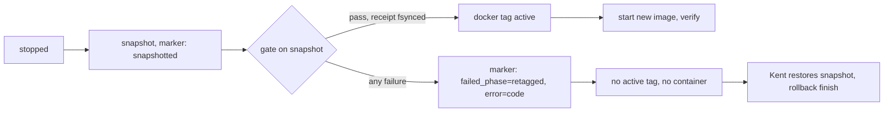

# Implementation Plan: Vikunja repeat cutover support

**Branch**: `fix/vikunja-repeat-cutover` | **Date**: 2026-11-08 | **Spec**: `kitty-specs/vikunja-repeat-cutover-01M6YRJG/spec.md`
**Input**: Mission specification, Codex read-only research (`research.md`), and planning decision 01M6Z0BCB1XHDQ4MZ14PYBA1P6.

Tracking: see #1095. Follow-up to: see #1087.

## Summary

The STAGE and ACTIVATE route built for the first Vikunja cutover cannot run a second one. It rejects the `vX.Y.Z-rrule.N` version and the gzip archive, it mishandles a tagged image load, and its rollback guard refuses a valid restore. This plan repairs those faults and adds a fail-closed gate between the write-boundary snapshot and image selection. It also adds a preflight that finds a baseline mismatch before the outage, removes private values from deploy output, and adds a reviewed acceptance verifier. The change ships as two PRs, because an ACTIVATE manifest executes on merge.

Kent confirmed this approach on 2026-11-08 and delegated the merges once review and CI pass. The database restore, browser acceptance and ACCEPT or ROLLBACK stay with Kent.

## Technical Context

**Language/Version**: Python 3.12 on Office2; CI also runs 3.13
**Primary Dependencies**: Python standard library, including `sqlite3`; Docker and Compose on Office2; felix-deployer manifest pipeline. No new dependencies, so no supply-chain review applies.
**Storage**: SQLite (WAL) at `/data/services/vikunja/data`, read only through private copies. Committed JSON for the release record and baseline. Private receipts on Office2.
**Testing**: pytest with synthetic fixtures. Focused: `python3 -m pytest -q tests/deploy/test_vikunja_cutover_change_set.py`. Full: `python3 -m pytest -q --ignore=docs/archive`. Docs: `python3 tooling/scripts/validate_docs.py`.
**Target Platform**: Office2, Ubuntu 24.04
**Project Type**: Single repository; deploy helpers, operator scripts, manifests and a runbook
**Performance Goals**: The gate takes at most `min(30 seconds, remaining outage)`
**Constraints**: Total outage at most 300 seconds, including the 180-second readiness poll. No private values in git or deployer output. Compose stays on `office2.local/vikunja:active` with `pull_policy: never`. Manifests 0033 and 0034 stay unmodified.
**Scale/Scope**: One service and one small database; 155 pre-upgrade migrations, ten added

## Charter Check

| Gate | Status | How it is met |
|---|---|---|
| Manifest discipline | Pass | STAGE and ACTIVATE go through `deploys/queued/`, using helpers under `scripts/deploy/` |
| Tier 2 protocol | Pass, with an operator step | Both manifests stay tier 2. The operator confirms a Restic backup at most 24 hours old before ACTIVATE (quickstart step 4) |
| Rebaseline obligation | Pass | Manifests are audited surfaces; the closing record states `Rebaseline: automated — felix-deployer (deferred-confirm) on the post-merge deploy` if that is what ran |
| Pytest for helpers | Pass | Each concern below names its tests |
| Fixtures mirror real inputs | Pass | Fixtures reuse the published archive's shape and real schema shape, with synthetic rows only |
| No dead code | Pass | The gate is called from ACTIVATE, the verifier and preflight from the runbook and quickstart, the baseline loader from the gate and preflight |
| Integration verification | Pass | STAGE on Office2, preflight on a private copy, then ACTIVATE with A1–A3, B3 and B4 as the live verification |
| Doc validation | Pass | Runbook changes pass `validate_docs.py` |

Re-checked after design: no violations.

## Project Structure

### Documentation (this mission)

```
kitty-specs/vikunja-repeat-cutover-01M6YRJG/
├── spec.md
├── plan.md
├── research.md
├── data-model.md
├── quickstart.md
└── contracts/baseline-and-gate.md
```

### Source Code (repository root)

```
scripts/deploy/vikunja_release/core.py          # version, gzip, release schema, baseline binding
scripts/deploy/vikunja_release/baseline.py      # NEW: comparison, schema identity, receipt
scripts/deploy/vikunja_release/dbsafety.py      # rollback guard, output scrub
scripts/deploy/deploy-vikunja-release-stage.py  # tagged load
scripts/deploy/deploy-vikunja-release-activate.py  # gate, output scrub
scripts/vikunja/rollback_release.py             # recovery, write count, exact version
scripts/vikunja/preflight_release_baseline.py   # NEW: FR-013
scripts/vikunja/verify_release_upgrade.py       # NEW: FR-009
scripts/vikunja/build_release_baseline.py       # NEW: writes the committed baseline (FR-010)
services/vikunja/release.json                   # new release record
services/vikunja/baselines/v2.7.1-670-420c7bcb75.json  # NEW: data-free baseline
deploys/queued/vikunja-release-stage.yaml       # PR1
deploys/queued/vikunja-release-activate.yaml    # PR2
docs/design/architecture/data/service-inventory.json, docs/design/architecture/service-inventory.md  # PR2
docs/runbooks/vikunja-release-cutover.md
tests/deploy/, tests/vikunja/ as present
```

**Structure Decision**: Extend the existing route. All comparison logic lives in one module, `baseline.py`, so ACTIVATE, preflight and acceptance cannot disagree about what a baseline match means.

## Key Design Decisions

### D1. Baseline binding

`services/vikunja/baselines/v2.7.1-670-420c7bcb75.json` holds only code-derived and schema-derived facts. `release.json` pins its path and SHA256. The binding is optional in the release schema, so the frozen first-cutover record stays valid. `core.load_release()` validates its shape, and `baseline.load_bound()` hashes and parses the same bytes. The gate fails closed with `GATE_BASELINE_UNREADABLE` when the binding is absent, and the change-set tests require it for the current release. Format: `contracts/baseline-and-gate.md`.

### D2. Gate placement and failure state



The gate runs after `_advance("snapshotted", …)` and before `docker tag`. No new marker phase is added. A failure records `phase=snapshotted`, `failed_phase=retagged`, `outcome=failed` and a stable gate error code. Recovery uses rollback `--prepare` and `--finish`, never `--recover-pre-snapshot`, because `snapshotted` is not admissible there.

The gate reads only the private snapshot and writes the receipt before the tag. If the receipt cannot be durably written, the gate fails.

### D3. Preflight (FR-013)

`preflight_release_baseline.py` takes a stable double copy of the live database and WAL, using the runbook B3 method, into a private folder under `/data/services/vikunja/failures`. It consolidates through the same `dbsafety` route as the snapshot, runs `baseline.compare()`, and prints only a result code and the elapsed consolidation and gate time. It removes its copy on exit. It never opens the live database, and it writes no receipt that ACTIVATE reads. A non-pass result stops the cutover before any outage.

Preflight cannot prove the snapshot taken at the write boundary. The gate still runs in ACTIVATE. An unstable copy is inconclusive: it is neither a pass nor a baseline mismatch, and the cutover does not proceed until preflight passes.

### D4. Privacy at the producer

Remove snapshot paths, hashes, task counts, outage times and conversion aggregates from ACTIVATE details and `record_installed()` reporting. This includes the `private_log` location emitted by the shared `core.run_cli()` failure path, whose filename embeds a timestamp, and every captured-log path ACTIVATE emits. Locations stay private and output carries stable codes. `rollback_release.py` is operator-run and not retained by the deployer, so its output is outside NFR-002. Sanitizing at the deployer is not enough, because failed-command excerpts are forwarded verbatim. Tests seed recognisable path, timestamp and aggregate values and assert that they do not appear in stdout, stderr, forwarded failure excerpts or installed reports, on both ordinary and unexpected failures.

### D4a. Crash before the snapshot phase is recorded (post-plan review, 2026-11-08)

A process death after ACTIVATE creates its marker and before `snapshotted` is recorded leaves `outcome=None`, for example `phase=stopped`. Today replay refuses that marker and `--recover-pre-snapshot` requires `outcome=failed`, so the service would stay down with no supported route.

`--recover-pre-snapshot` also admits an unfinished marker whose phase is `started` or `stopped`, under both existing locks, with the same exact release, config, rollback image and pre-version checks. The active tag may be absent, or may still be the previous image if the crash fell between Compose down and tag removal; any other value is refused. The database has not been touched by a new image in these phases, because retag cannot have happened. `snapshotted` and later stay excluded. Tests cover a crash during snapshot and one between Compose down and tag removal, through to the previous image running.

### D5. Two PRs from one mission

- **PR1 (STAGE)**: everything except `deploys/queued/vikunja-release-activate.yaml` and the inventory promotion.
- **PR2 (ACTIVATE)**: those paths only, opened after STAGE applies and preflight passes.

Mechanism: all work packages, including the ACTIVATE package, consolidate onto `fix/vikunja-repeat-cutover`, which is never merged to `main` whole. Nothing there executes, because the deployer only reads `main`. PR1 is a branch from current `main` holding the mission tree minus the three ACTIVATE paths. PR2 is a new branch from `main` after PR1 merges, STAGE applies and preflight passes, adding exactly those three paths. The ACTIVATE package is done when it is prepared, tested in the ACTIVATE tree state and reviewed; it does not wait for live events.

The change-set tests are phase-aware: with only STAGE queued, they require STAGE bindings and the previous release in inventory; with ACTIVATE queued or applied, they require the new identities in both. A malformed queued ACTIVATE never falls back to historical manifest 0034. Both PR diffs are checked against their exact path sets during assembly, because the existing path-set test checks constants, not the diff.

### D6. Baseline generation is outside the Codex boundary

Codex implements with synthetic fixtures and must not read `~/.local/share/rrule-office2-cutover`, `~/.local/state/vikunja-acceptance-31YVSX` or any database copy. Claude Opus 5.5 generates the committed baseline from private copies using the reviewed `baseline.py`, and Claude Sonnet 5.5 reviews it as part of the STAGE package.

## Complexity Tracking

No charter violations.

## Implementation Concern Map

### IC-01 — Release and archive compatibility

- **Purpose**: Let the route accept and load the published release while keeping exact byte and image identity checks.
- **Relevant requirements**: FR-001, FR-002, FR-003
- **Affected surfaces**: `core.py` (including the optional baseline binding shape), `deploy-vikunja-release-stage.py`, stage, core and readiness tests. The frozen first-cutover release fixture is created here.
- **Sequencing/depends-on**: none
- **Risks**: `docker load` changes tags before verification, so collisions are preflighted. Cleanup never removes by image ID alone. The route has no automatic image cleanup; imported-tag cleanup is the runbook procedure.

### IC-02 — Rollback correctness

- **Purpose**: Make the safety net accept the correct snapshot and refuse every other one.
- **Relevant requirements**: FR-004, FR-005, FR-006, FR-007
- **Affected surfaces**: `dbsafety.py` (`rollback_guard` and output), `rollback_release.py`, DB and rollback tests
- **Sequencing/depends-on**: IC-01
- **Risks**: A wrong version must fail before any tag or start. `snapshotted` stays out of pre-snapshot recovery, while unfinished `started` and `stopped` markers are admitted (D4a). Backfill is labelled and is not subtracted from the acknowledged write count.

### IC-03 — Baseline, gate and acceptance

- **Purpose**: Prove the restore point before image selection and give Kent evidence afterwards.
- **Relevant requirements**: FR-008, FR-009, FR-013, NFR-001, NFR-002, NFR-003
- **Affected surfaces**: `baseline.py`, `deploy-vikunja-release-activate.py`, new preflight and verifier scripts and tests
- **Sequencing/depends-on**: IC-01; integrates with IC-02 for gate-failure recovery
- **Risks**: Schema text can differ across SQLite versions, so identity is tested across Python 3.12 and 3.13 and a mismatch fails for review. The outage budget is tight only if the snapshot is slow; preflight measures it.

### IC-04 — STAGE change set and runbook

- **Purpose**: Carry the exact release identities and repeat-cutover instructions in PR1.
- **Relevant requirements**: FR-010, FR-012
- **Affected surfaces**: `release.json`, committed baseline, queued STAGE manifest, phase-aware change-set tests, consistency tests, runbook
- **Sequencing/depends-on**: IC-01, IC-02, IC-03
- **Risks**: The published-download identities need a fresh check at ingress. The runbook's historical conversion steps must be clearly separated from repeat-cutover steps.

### IC-05 — ACTIVATE change set

- **Purpose**: Prepare the separate production decision in PR2.
- **Relevant requirements**: FR-011
- **Affected surfaces**: queued ACTIVATE manifest, service inventory
- **Sequencing/depends-on**: IC-04; merged only after STAGE applies and preflight passes
- **Risks**: Inventory must not be promoted early. No Compose change.
